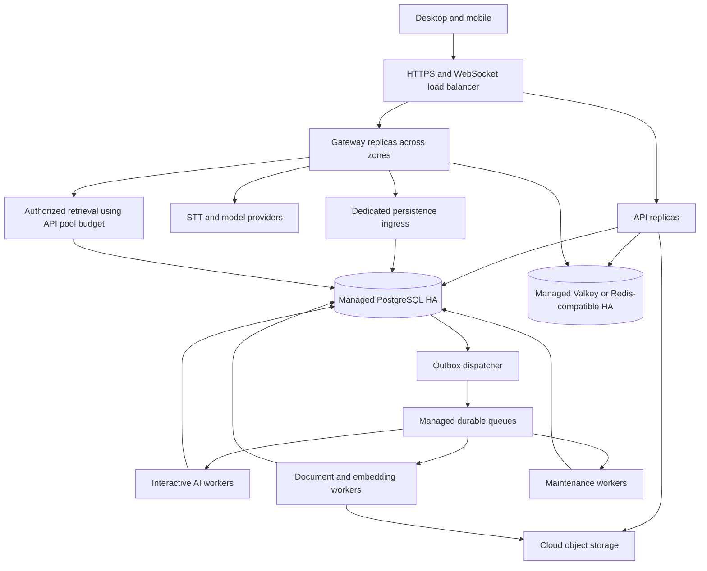

# Career Pilot: redesign for 1,000 concurrent users

Design study, 2026-11-23. The findings below describe the repository at the initial review
(through migration 0028). This is not a capacity certification. No production database,
provider quotas, or customer data was inspected.

**Implementation update:** migrations `0029`–`0035` now implement the account/workspace
split, independent private keys, durable sessions, generation-fenced operations/outbox,
restartable interactive execution, source revisions, connected usage and retryable retention.
The [production data foundation](production-data-foundation.md) is the authoritative guide
to the implemented behavior, deliberate compatibility choices, limitations and coordinated
cutover. This earlier study includes additional design options and future infrastructure
work; it should not be read as a list of features all shipped by these migrations.
No production migration or infrastructure change has been applied.

## Recommendation

Keep PostgreSQL, pgvector, the Python service stack, and the desktop/mobile clients. Replace the overloaded account/workspace ownership model and make accepted work durable. Prepare the application for an eventual production deployment beyond the single-host Stage 0 environment. Preserve the useful service boundaries: API, live gateway, and workers. Give persistence, interactive AI, ingestion, and maintenance separate concurrency budgets; dedicated production compute can follow later.

**Current-stage decision, clarified 2026-11-23:** the app is in internal testing with fewer than three users and fewer than two concurrent users. Keep the existing deployed infrastructure, idle shutdown behavior, and resource sizes. The immediate design and implementation work targets the production data model, reliable application behavior, and replaceable deployment dependencies. The regional infrastructure below is a future target, not a request to provision it now. Preparing code, migration scripts, configuration, and unapplied infrastructure definitions does not itself add recurring cloud resources.

The acceptance target is 1,000 simultaneous live host calls, with a separately specified guest/companion allowance, not merely 1,000 accounts or open sockets. Validate ordinary browsing and 1,000 simultaneous Ask generations as separate workload mixes. There is no evidence yet that a particular instance size or replica count can meet that target.

The design intentionally avoids database-per-user, sharding, a separate graph database, a universal entity/ACL framework, and a separate service for every domain. Those would add operating and query complexity without addressing the observed limits.

## 1. What the repository actually needs changed

| Current implementation | Consequence at concurrency | Target change |
| --- | --- | --- |
| GCP Stage 0 puts API, gateway, worker, PostgreSQL, Valkey, and ElasticMQ on one `e2-medium`; the data disk is 10 GB. | One host or disk problem affects the entire app. Independent scaling is impossible. | Regional compute pools and managed stateful services. |
| PostgreSQL container is limited to 512 MiB and 60 connections; Valkey data limit is 192 MiB. | Existing configuration is a development deployment, not a production capacity plan. | Size using the measured mixed workload and a fleet-wide connection budget. |
| Nginx has one worker and `worker_connections 1024`. | Proxied sockets use client and upstream connections; this cannot serve 1,000 ordinary proxied WebSockets concurrently. | Managed HTTPS/WebSocket load balancer and tested connection limits. |
| `users` represents accounts and person workspaces; `profiles` and `career_os_people` compensate. | Ownership, authorization, deletion, settings, and key ownership have inconsistent meanings. | Explicit accounts, workspaces, memberships, and external identity links. |
| A session becomes a database row at its first flush. | Live ownership/privacy must be checked in two stores; seats and companions cannot have normal session FKs. | Create the durable session before gateway admission. |
| Session history performs per-row database/Valkey privacy checks. | A history page can become dozens of additional round trips. | One database-authorized page query, with authoritative durable privacy. |
| Important session child lookup/FK indexes are absent. | Replay, history, and deletion can scan increasingly large child tables. | Add workload-specific indexes and verify them under actual RLS roles. |
| One queue and ten default worker slots mix flush jobs with AI work lasting up to 600 seconds. | Model stalls can delay retaining a live call. | Reserved persistence workers and separate interactive/background queues. |
| Ask/practice operations use API `BackgroundTasks`; queue publication elsewhere happens after domain commits. | API restarts or publication failures can strand accepted operations. | Durable operations and a transactional outbox. |
| Worker claim expiry uses original `started_at`; heartbeat only extends queue visibility. | A stale worker can overlap a replacement and overwrite status/results. | Renewable database leases and generation-fenced commits. |
| Gateway output/log buffers are not fully byte-bounded; admission can proceed when coordination fails. | Slow clients or outages can exhaust memory or create conflicting ownership. | Explicit admission, ownership fencing, bounded buffers, and degraded behavior. |
| Audio replay deduplication resumes from received-frame high-water marks. | A crash after receipt but before STT finalization can discard needed replay. | Separate received, finalized, and durably retained checkpoints. |
| Resume rows change content in place; durable sessions do not pin the exact resume revision. | Historical answers are difficult to reproduce or explain. | Immutable revisions and durable source provenance. |
| Retention settings exist without an identified history-purge worker; usage is rebuilt from remaining sessions. | History grows without policy enforcement; deleting history can change usage inputs. | Explicit expiry/deletion workflows and a content-free usage ledger. |

Repository evidence is listed in section 13. The Nginx upstream-connection behavior is documented by [Nginx](https://nginx.org/en/docs/ngx_core_module.html#worker_connections). These are source findings; failure windows should be reproduced before describing them as observed production incidents.

## 2. Capacity envelope and explicit assumptions

Audio framing in this repository is 16 kHz PCM16 mono per channel, normally 100 ms / 3,200-byte speech frames. Both speaker channels are transcribed by default.

| Quantity | Planning calculation at 1,000 live host calls |
| --- | --- |
| Host client WebSockets | 1,000, plus guest and companion connections |
| STT streams | Up to 2,000, plus reconnect reserve |
| Audio frames, both channels continuously speaking | 20,000 frames/second |
| Client-to-gateway audio payload | 64 MB/second, or 512 Mbit/second |
| Gateway-to-STT audio payload | Approximately the same payload rate, separately from ingress |
| Audio at an assumed 30% speech duty per channel | 19.2 MB/second and 6,000 frames/second in each audio direction |
| Final transcript rows, assuming one segment per call every five seconds | 200 rows/second; 5.76 million rows over eight hours |
| If that segment rate applies independently to both channels | 400 rows/second; 11.52 million rows over eight hours |
| Present 30-second flush jobs, if every call has new log data | About 33/second; 960,000 distinct job keys over eight hours |

These are explicit synthetic assumptions, not measured traffic. Silence detection reduces audio traffic, while TLS, headers, screenshots, answers, guest fanout, replay, and provider responses add traffic. Audio bytes are not PostgreSQL write volume. At 200 transcript rows/second for eight hours/day, 30 days produces 172.8 million rows; retention and lifecycle become material well before account count becomes a useful database-size metric.

Test at least three mixes:

1. **Calls:** 1,000 host calls, 300 additional guest/companion sockets as an initial test allowance, and normal history/upload traffic. Change the allowance if the product promises more guests.
2. **Interactive AI:** 1,000 simultaneous Ask/practice generations, with long answers and cancellation. Do not assume all 1,000 calls also issue Ask simultaneously unless that becomes a requirement.
3. **Content and recovery:** bulk document ingestion, a transcript backlog, history reads, and retention work competing at the same time.

Provider capacity is an independent gate. An illustrative call pattern of six detector decisions, two fast answers, one deep answer, and two embeddings per call/minute requires 6,000 detector RPM, 2,000 fast RPM, 1,000 deep RPM, and 2,000 embedding RPM fleet-wide. Token quotas require real prompt-length distributions. Hedges, speculation, retries, and prewarming add load; 2,000 STT sockets need an approved concurrency allowance. No quota or provider price was verified in this review.

## 3. Deployment architecture

Use the same application code, relational schema, and versioned migrations in internal testing and eventual production. Deployment profiles select addresses, credentials, TLS, concurrency budgets, and replica counts. There must be no simplified test-only ownership model or separate production schema that requires another domain rewrite at launch. Keep compatible PostgreSQL/pgvector versions and exercise the real application roles and authorization policies in integration tests.

| Boundary | Prepare in the application now | Change when deploying production |
| --- | --- | --- |
| PostgreSQL | Explicit ownership/FKs, workload indexes, durable sessions, versioned migrations, role-specific DSNs, and bounded pools | Provision managed PostgreSQL; migrate data; configure TLS, roles, extensions, backup/PITR, and connection budgets; verify compatibility |
| API, gateway, workers | Independently runnable processes, health/readiness, graceful shutdown, retry safety, and externally stored coordination | Place the same application images in separate compute pools and increase replicas |
| Worker lanes | Separate persistence/interactive/background concurrency budgets on the existing host; reserve room for live calls | Assign independent worker capacity and autoscaling policies |
| Queue | A narrow transport contract for publication, receive, acknowledgment, retry/lease extension, and dead-letter handling; database-backed operations/outbox and idempotency remain authoritative | Implement and contract-test a Pub/Sub adapter before selecting it; retain the SQS/ElasticMQ backend during internal testing |
| Cache and coordination | Configured endpoints, bounded disposable caches, ownership fencing, and reconnect/failure behavior | Select a compatible managed Valkey/Redis service and verify commands, TLS, and replication behavior |
| Files | Object-store references with stable object keys; temporary local files are not authoritative state | Configure the selected object-store adapter, identity, and lifecycle policies; the current GCP deployment already uses Cloud Storage |
| Infrastructure as code | Keep Stage 0 usable; prepare an explicit production environment that reuses suitable modules, with separate state and configuration | Provision and validate the production environment through a reviewed migration/cutover |

Configuration changes cover compatible deployments; they do not make different provider protocols interchangeable. In particular, the current SQS consumer cannot use Pub/Sub by changing its URL. PostgreSQL migration also requires validating extension support and managed-service privilege restrictions. Add only the concrete adapters needed for the chosen target, not a universal cloud framework.

Before provisioning a fleet, use local containers/processes and synthetic dependencies to test two API/gateway/worker instances, duplicate delivery, process restarts, lease expiry, and reconnects. This checks deployment assumptions cheaply. It does not certify 1,000-call capacity or managed-service failover; representative production load and recovery tests remain a later gate.

For the future production deployment, stay on GCP unless there is a separate business reason to migrate clouds; the AWS infrastructure is explicitly retained but unused. Use regional managed instance groups for long-running container workloads, with independent API, gateway, and worker pools spread across zones. This extends the existing Compute Engine operating model without requiring a Kubernetes migration. Keep production capacity warm; remove idle-stop/wake behavior from production when that environment is launched. Internal testing can continue using Stage 0.



The persistence ingress is a deployment mode of the worker/API codebase with its own bounded connection pool and role, replicated across zones, not a separate product service requiring a new repository. It commits bounded final-event batches directly to PostgreSQL. This is the initial chosen live durability path: it avoids introducing a second authoritative event journal and its replay/authorization complexities at this scale. The queue handles accepted AI/ingestion/maintenance operations. If measured persistence ingress throughput or outage buffering later requires a durable event broker, add it behind the same batch interface with explicit accepted-versus-committed acknowledgments.

Gateways obtain uncached live memory through a bounded internal retrieval endpoint using the API connection budget. This replaces independent PostgreSQL pools on every gateway; do not retain the current five-connection gateway pools in addition to the budget below. Retrieval requires a verified session/account/workspace ticket, bounded candidate counts, and an explicit timeout. Prepared context remains locally cached where authorized.

Recommended managed components:

- Cloud SQL for PostgreSQL with regional HA, private connectivity, tested pgvector support, automated backups, and explicitly enabled point-in-time recovery. Keep critical authorization and immediate post-write reads on the primary.
- Managed Valkey or compatible Redis HA for live coordination, disposable replay, and prepared context. Contract-test Lua, Streams, cluster hash slots, TLS, expiration, and reconnect behavior against the selected service/version before adopting it. Separate critical live state from large evictable caches if memory pressure or eviction requirements conflict.
- Pub/Sub behind a queue interface, with distinct subscriptions/worker budgets for interactive AI, document processing, and maintenance. Retain idempotency even if a delivery feature reduces redelivery. The current SQS/ElasticMQ adapter needs an actual Pub/Sub implementation and tests; changing an endpoint is insufficient.
- Cloud Storage for immutable file objects, bounded live snapshots if needed, and exports. Use workload identities/native integration where practical; do not propagate one VM identity into all runtime roles.

[Cloud SQL HA](https://docs.cloud.google.com/sql/docs/postgres/high-availability) synchronously replicates regional storage before acknowledging commits, but failover still interrupts connections. [PITR](https://docs.cloud.google.com/sql/docs/postgres/backup-recovery/pitr) restores into a new instance and requires a rehearsed reconnection procedure. [Regional instance groups](https://docs.cloud.google.com/compute/docs/instance-groups/regional-migs) provide zonal distribution; application headroom is still our responsibility. [Pub/Sub](https://docs.cloud.google.com/pubsub/docs/publisher) is designed for at-least-once delivery. [Managed Redis HA](https://docs.cloud.google.com/memorystore/docs/redis/high-availability-for-memorystore-for-redis) must not be confused with guaranteed durability of every acknowledged cache write.

## 4. Target relational model

### Identity and authorization

| Table | Main fields and invariant |
| --- | --- |
| `accounts` | `id`, display name, status, settings; a sign-in principal only |
| `account_identities` | `account_id`, provider, issuer/realm, subject, verified email; unique provider/realm/subject |
| `refresh_tokens` | Account, token hash, family, expiry, revocation, replacement; no plaintext tokens |
| `workspaces` | `id`, display name, lifecycle status, retention/consent policy, creator attribution |
| `workspace_memberships` | `(workspace_id, account_id)`, role, status, authorization revision |
| `external_workspace_links` | Provider, realm, external person ID, workspace; unique in the actual external identity namespace |
| `account_keys`, `workspace_keys` | Separate versioned wrapped keys for private account content and shared workspace content |

An account can access several workspaces and a workspace can have several members. `created_by_account_id` is attribution, not ownership. Account removal cannot cascade-delete a shared workspace. Workspace ownership transfer/deletion is an explicit transaction that locks the workspace and preserves at least one active owner while the workspace is active; enforce that invariant with a deferred database constraint trigger and test concurrent owner removal.

All shared domain tables use `workspace_id`. Account-private features use `account_id` plus a workspace association when needed. Eliminate overloaded domain `user_id` and legacy `job_id` names. The authenticated actor and selected workspace are both retained in transaction-local context. Settings come from explicit account or workspace policy, not from copying whichever administrator originally created a profile.

RLS requires authorized membership and the correct row audience. The server establishes transaction context only after token verification; clients never receive database credentials or choose trusted actor settings. Keep narrow role grants and FORCE RLS. Owner/system bypass paths remain small, audited, and unavailable to public requests. Avoid multiple permissive policies that accidentally OR a broad workspace grant with a private-account rule. [PostgreSQL RLS](https://www.postgresql.org/docs/16/ddl-rowsecurity.html)

### Career and workplace

| Tables | Relationships and invariants |
| --- | --- |
| `applications` | Workspace, company, role, stage, job description, selected resume revision; consistent `application_id` naming |
| `interviews` | Application + workspace FK; scheduled time and round |
| `resumes` | Stable container; one base per workspace, tailored container belongs to one application |
| `resume_revisions` | Immutable content/hash/source per resume; unique resume/revision number; processing state changes separately |
| `employers` | Workspace-owned companies and the person's role there |
| `work_logs` | Stable employer + workspace + day identity; unique employer/day; selected current revision |
| `work_log_revisions` | Immutable encrypted content/hash, same workspace/employer, unique work-log/revision number; attachments bind to a concrete revision |
| `company_documents` | Stable employer-owned document identity |
| `company_document_revisions` | Immutable file/hash/extracted text identity; replacement adds a revision |
| `knowledge_chunks` | Exact document revision, ordinal, workspace/employer, encrypted body, embedding model/vector |
| `file_objects` | Workspace-owned immutable object key, size, MIME type, checksum, lifecycle and encryption metadata for these source files |
| `memory_nodes`, `memory_edges`, `memory_proposals` | Keep the contextual graph; typed ownership/kind/domain/status, flexible content, explicit source provenance |

Use concrete FKs for provenance: resume revision, document revision, work-log revision, or session as appropriate. Source-link tables may represent multiple origins, but each FK targets a real domain table. Do not replace these with an unconstrained `entity_type/entity_id` pair. A future account-private attachment table should have account ownership explicitly rather than overloading workspace file access.

Strong invariants include one base resume, tailored-resume pairing only with its application, same-workspace references, same-employer work-log/document/chunk associations, and immutable revision content. Small immutable revision rows are distinct from a mutable processing-operation row. Sessions pin the selected resume revision and generated context version; the current application selection is not the historical record.

### Session visibility: a deliberate product decision

**Recommended target:** visibility is selected at session creation and immutable for that session. A workspace-visible call uses shared context. An account-private call may use that account's personal context. Private content never enters shared memory extraction or a workspace cache.

This changes current behavior: adding private context halfway through a shared call would require a new private session or an explicitly separate private artifact. If keeping the existing shared-to-private conversion is mandatory, use the alternative below before implementing the schema. Do not silently remove that capability during migration.

For the recommended immutable design, the parent contains:

```text
sessions(
  id PK, workspace_id FK,
  visibility CHECK IN ('workspace', 'account_private'),
  private_owner_account_id NULLABLE FK accounts,
  audience_id GENERATED AS coalesce(private_owner_account_id, workspace_id),
  created_by_account_id, payer_account_id,
  application_id, interview_id, employer_id, resume_revision_id,
  consent_snapshot, retention_policy_version, expires_at,
  state, started_at, ended_at,
  writer_generation, persistence_checkpoint,
  UNIQUE(id, workspace_id, visibility, audience_id),
  CHECK((visibility = 'account_private') = (private_owner_account_id IS NOT NULL))
)
```

This is schematic, not runnable DDL. `visibility` and `audience_id` are non-null. Child tables carry `(session_id, workspace_id, visibility, audience_id)` and a composite FK to the complete parent tuple. A nullable private-owner column alone must not be used in that composite FK: ordinary nullable composite references can skip validation. Updates that change session audience are forbidden.

Child RLS can then check membership plus `(visibility = 'workspace' OR audience_id = current_actor)` directly, without repeatedly traversing question-to-session joins. The duplication is small, immutable, database-constrained authorization metadata, not copied mutable business content.

`answers` also carries `session_id` and references the matching question/session/workspace/audience tuple. `session_seats` and `companion_attachments` have actual session FKs because the parent exists before live activity. Guest access remains a narrow explicit session capability; it does not grant workspace membership or unrestricted child-table access.

If dynamic privacy conversion is retained instead, do not use immutable copied audiences. Keep authoritative visibility on the durable parent, indexed parent-based child RLS, and coordinated shared/exclusive session locks for response reads and conversion. Stop shared output, revoke guest access, bump authorization/cache versions, and only then generate with private context. Previously observed shared output cannot be recalled. PostgreSQL documents race considerations for policies that consult other tables; preserve the protection current API locks attempt to provide.

### Private features, usage, and operations

Keep Ask conversations/messages, practice sessions/turns, calendar connections/context, personal context requests/brief versions, and integration credentials. Give each an unambiguous account owner and workspace association, with same-owner FKs and workspace authorization checks. Keep provider credentials separate from the identities used to sign in. Publish only explicitly approved, sanitized derived facts into workspace memory.

Introduce durable `operations`, `outbox_events`, `scheduled_jobs`, deletion work records, and a content-free `usage_events` ledger. Usage is attributed to an explicit payer account and workspace, not inferred from the person whose content is used. Deduplicate usage by session/event/interval, split time across billing-day boundaries, and retain/reconcile usage independently of transcript deletion. The change feed remains a compact invalidation index, not an audit history.

## 5. Query design and write amplification

Use typed columns for ownership, FK relationships, lifecycle, timestamps, filterable status, revision, and idempotency. JSONB remains suitable for flexible extracted fact bodies and provider metadata. Encrypted narrative content is fetched only when required.

| Read path | Candidate index, to verify with actual SQL and RLS |
| --- | --- |
| Account's workspace list | Memberships `(account_id, status, workspace_id)` |
| Application list | `(workspace_id, created_at DESC, id DESC)`; stage variant only if needed |
| Session history | `(workspace_id, started_at DESC, id DESC)`; audience-specific alternatives if shared-workspace selectivity warrants them |
| Chronological transcript | `(workspace_id, session_id, start_ms, channel, segment_number)` |
| Session questions | `(workspace_id, session_id, detected_at, id)` |
| Answers | `(workspace_id, question_id, created_at, id)`; direct session index only if its query needs it |
| Session outputs | `(workspace_id, session_id, kind)` |
| Employer logs | `(workspace_id, employer_id, day DESC)` |
| Chunks | `(workspace_id, employer_id, document_revision_id, ordinal)` and exact vector filter/model indexes as needed |
| Retention | Active/eligible rows by `(expires_at, id)` |
| Runnable operations | Partial index by status, due time, priority; lease expiry index for recovery |

Referencing FKs are not automatically indexed. Tenant-leading indexes are useful for tenant reads, but background FK/cascade lookups may need different ordering; verify both rather than adding indexes blindly. [PostgreSQL constraints](https://www.postgresql.org/docs/16/ddl-constraints.html)

Use keyset pagination and bounded response sizes. A history page must not decrypt transcripts or make one privacy call per row. Query only the question IDs needed by an incoming answer batch, not every historic question on every flush.

For transcript persistence: bound batches by rows, bytes, and elapsed time; get the appropriate encryption key once per batch; encrypt bounded payloads outside long transactions where safe; insert with multi-row INSERT/UNNEST and conflict handling; advance the checkpoint in the same transaction. Preserve existing commit-before-trim semantics. Avoid direct COPY FROM into RLS-protected tables. [PostgreSQL COPY](https://www.postgresql.org/docs/16/sql-copy.html)

No external LLM, embedding, object download, or slow client stream may hold a normal database transaction open. Read authorized bounded metadata, release the connection, do external work, then conditionally commit using operation generation/source revision checks. Define revocation behavior for already-started reads and use short authorization tickets only where the privacy policy permits them.

For AI retrieval, select a bounded candidate set using metadata and search indexes before fetching/decrypting excerpts. Replace repeated full transcript decryption with derived transcript search chunks linked to the session's audience and retention policy. Scope retrieval by workspace, employer/application, source revision, and embedding model.

Start with exact vector search over selective indexed workspace/employer filters. Do not add one global HNSW index and assume tenant-filtered recall is preserved: approximate search filtering can under-return. Benchmark selective exact search against iterative ANN scans and scoped indexes using p95/p99 latency and recall. [pgvector filtering](https://github.com/pgvector/pgvector#filtering)

Plan for high-volume transcript lifecycle without partitioning every table. At sustained million-row/day ingestion, time partitions can help retention. If adopted, carry an immutable session bucket into children and include the partition key in dedupe/unique constraints; PostgreSQL partitioned uniqueness has limitations. Keep sessions/ownership tables unpartitioned initially and test partition pruning, FK behavior, and per-user expiry. Calendar partitions alone do not enforce arbitrary per-user retention. [PostgreSQL partitioning](https://www.postgresql.org/docs/16/ddl-partitioning.html)

## 6. Live session and durability contract

1. API authenticates the account, verifies membership/entitlement, fixes visibility and initial consent, resolves source revisions, and creates `sessions` in a short transaction. It returns a short-lived session ticket. Retention consent can subsequently be tightened/revoked through a versioned control path; immutable visibility does not mean irrevocable recording consent.
2. Gateway admission checks task capacity and provider budgets. Ownership acquisition uses a durable monotonic generation; Valkey carries fast lease/discovery state but is not the only authority for committing retained content. The lifecycle is `created -> admitted -> active -> closing -> ended/failed`; unclaimed tickets/created sessions expire, and failed admission releases reservations. Claim/takeover requests are idempotent.
3. Raw audio goes to STT. Finalized segment/answer events have stable event IDs, a producer sequence within `(session_id, writer_generation)`, and a consent revision. Partial transcripts and token deltas are ephemeral.
4. Gateway submits bounded batches to dedicated persistence ingress. It encrypts with the appropriate scoped key, then validates the current generation, permitted lifecycle state, consent, and audience inside the same transaction that inserts rows and advances the checkpoint. A session row lock or equivalent conditional update serializes this with takeover and consent changes. A saved acknowledgment is sent only after commit. Duplicate requests must match a stable batch ID and payload hash; returning an earlier receipt requires current authorization. A committed batch remains committed after takeover, while new stale-generation content is refused.
5. Checkpoints acknowledge only contiguous committed sequences within each generation, not the largest observed sequence. Takeover records abandoned unsaved ranges as explicit gaps and establishes the new generation's boundary. Finalization records expected checkpoints, reconciles pending parents/questions, and inserts outbox work for post-call processing. Summary generation starts only after required content is committed or an explicit missing-content condition is recorded.

This path uses short shared service pools, not one PostgreSQL connection per live session. Start with final-event batch latency of roughly 0.5-2 seconds as a tuning range, constrained by measured traffic and saved-content UX. There is no PostgreSQL write for every audio frame or token.

Keep separate received-audio, finalized-transcript, and durable-content checkpoints. A received-frame counter does not prove STT completion. The client replays from the safe processing boundary, subject to its bounded audio ring. The present ten-second audio replay buffer cannot recover a two-minute outage simply because session metadata can resume for two minutes. If replay capacity is exceeded, mark the gap; do not silently pretend speech was retained.

Bound all buffers by **bytes and age**: socket output, transcript partials, retained-event retry, screenshots, STT replay, and knowledge caches. Coalesce disposable partials/deltas. Stop admission before starving active calls. When retained-event persistence is unavailable, display pending status, retry within the chosen bounded window, then pause/fail that retained feature clearly rather than dropping data labeled saved. A gateway crash may lose unsaved in-memory material; the saved acknowledgment contract must make that distinction honest.

Use process-level immutable knowledge caches keyed by workspace/employer/version, with byte limits and reference counting. Do not build a separate multi-megabyte employer index for each call. Prune STT timeline metadata with finalized ranges. Deduplicate provider warming at the provider-client level.

For deployment, stop admission first, drain/checkpoint, then ask clients to reconnect with jitter. Do not interrupt every gateway at once. Separate liveness from admission readiness and report degraded provider/storage states. If ownership cannot be established, reject new sessions; avoid creating uncoordinated calls during a cache outage.

## 7. Durable work, queue isolation, and provider control

Persist a requested operation and its outbox event in the same transaction. A dispatcher sends a stable event ID to the appropriate managed queue, marking delivery only afterward. Duplicate dispatch remains possible and is expected. Scheduler advancement and scheduled outbox insertion also happen transactionally; a cache NX marker is not proof that work reached the queue.

`operations` includes owner scope, operation kind, input revision/hash, request idempotency key, status, lease owner, monotonically increasing lease generation, lease expiry, attempt count, due time, and error classification. Lease heartbeats update both durable ownership and queue visibility. Every result commit validates the generation and source revision; an expired worker cannot overwrite a newer attempt. Use provider idempotency where available, but do not claim it guarantees exactly-once external model charges.

Separate capacity for:

- **Persistence:** short commits, checkpoints, close events; no LLM calls.
- **Interactive AI:** Ask/practice and user-requested generation, with a latency budget.
- **Ingestion:** document parsing, extraction, embeddings, large rebuilds.
- **Maintenance:** expiry, deletion, reconciliation, usage rollups, and schedules.

Ask/practice use durable interactive operations. Stream their deltas through SSE or WebSocket, keep optional short-lived replay, persist bounded checkpoints/final output, and send cancellation notifications with a durable final commit guard. Avoid writing partial encrypted answers every 0.5 seconds and polling operation state internally every second at fleet scale. Polling remains a jittered fallback.

Use local semaphores plus fleet-level RPM, TPM, concurrent-generation, and STT-stream budgets. Reserve quota for live work. Under provider pressure, disable speculative/deep work and warming before refusing fast responses; cap hedges and never amplify throttled requests with automatic hedging. Use jittered retries, retry deadlines, and circuit breakers. A fallback provider counts as redundancy only after it is actually implemented and tested for language, latency, quality, and data handling.

Expire terminal operational records only after the maximum retry/redelivery/audit horizon. Keep durable content dedupe keys independently long enough to prevent old deliveries recreating results. Replace permanent per-flush job rows with a per-session checkpoint. Monitor queue age and throughput, not queue length alone.

## 8. Client traffic and synchronization

Preserve the current uncommitted improvements: scope-aware encrypted caches, shared in-flight requests, generation guards after edits/account changes, hidden-screen polling suppression, bounded memory/disk, safe conditional reads, and explicit no-store behavior for live/control endpoints. These are useful, not a reason to rewrite both clients.

Add jitter, one invalidation subscription per active account/workspace context, and an explicit fallback poll budget. Prefer streaming for active generation. Do not make every visible widget independently poll the same resource or launch synchronized refreshes after reconnect.

The latest 0028 already skips child history invalidations while a session is live. It uses one workspace-wide clock (`'*'`) before domain watermarks to avoid cross-domain deadlocks and commit-order gaps. Retain this property initially; the previous concern about incrementing it for every live transcript row no longer applies. Benchmark closed-session and extraction batches and coalesce redundant invalidations without substituting an unsafe sequence-only cursor.

Private payload caches must include account, workspace, audience, authorization version, and representation identity. Membership revocation or deletion invalidates subscriptions and future reads; offline cached data cannot be remotely recalled with certainty. Online revalidation and bounded expiry must reflect the privacy promise.

## 9. Encryption, retention, deletion, and provenance

Use account keys for private content and workspace keys for shared content. Keep wrapped keys out of gateway-wide credentials where possible; the dedicated persistence/retrieval paths have the narrow decrypt/encrypt rights they require. Searchable fact text and embeddings are sensitive derived data even if they are not application-encrypted. State that boundary honestly; this is not end-to-end encryption.

Introduce a versioned encryption context independent of mutable physical table names. Current ciphertext authenticates `app.<table>:<row-id>`, and wrapped keys bind the old user UUID. Preserve those legacy contexts until old content has been verified and re-encrypted. A SQL rename plus a new crypto table label can otherwise make valid data unreadable.

Resolve retention policy into explicit expiry metadata on sessions, revisions, and derived artifacts. Run bounded expiry jobs with durable progress and object-deletion outbox tasks. Source deletion must address chunks, embeddings, cached context, and excerpt copies in Ask/practice/session outputs according to a stated policy; retaining an excerpt is still retaining content.

Account deletion revokes credentials and access first, then removes account-private data and memberships. Workspace deletion is a distinct authorized operation. Small aggregates can use cascades; large histories and object sets need batched cleanup, checkpoints, and reconciliation rather than one huge cascading transaction.

Backups, replicas, queued events, exports, and cached DEKs participate in deletion policy. Removing a live wrapped-key row is not immediate erasure from backups containing that same wrapped key. Keep a durable deletion ledger and apply it before making a restored environment accessible. Test that restored data cannot silently restore revoked access.

## 10. Sizing experiments and recovery objectives

Do not use `sessions_per_task_target=60` as verified capacity. Define `S` as measured safe calls per gateway at the latency, memory, and provider limits. With three equally sized zones and one-zone tolerance, choose a balanced replica count satisfying `N * S * 2/3 >= 1000`, plus explicit burst/deploy allowance. For example, **if testing establishes S=50**, 30 gateway replicas are required to retain 1,000-call capacity after losing one of three equal zones. This is a formula example, not a prediction of how many replicas the app needs.

Initial experiments can compare gateway shapes of 2 vCPU/4 GiB and 4 vCPU/8 GiB, and PostgreSQL shapes of 4 vCPU/16 GiB and 8 vCPU/32 GiB with appropriate storage IOPS. These are test candidates, not procurement or capacity commitments. Scale gateways on active streams, event-loop lag, memory, and backlog; scale worker lanes by age and measured service time. CPU alone is insufficient for these I/O-heavy workloads.

Set a fleet-wide database connection budget before increasing replica limits. An illustrative 120-backend budget could reserve 30 API including internal live retrieval, 40 persistence, 15 interactive, 15 ingestion/maintenance, and 20 administrative/recovery connections. The correct total must be benchmarked; maximum client pools across replicas may not independently exceed it. A pooler can multiplex transactions, but transaction-local RLS context and asyncpg prepared statements need compatibility tests; run migration session advisory locks through a suitable direct connection. [PgBouncer features](https://www.pgbouncer.org/features.html)

Proposed acceptance objectives, to ratify and measure:

| Measure | Design objective |
| --- | --- |
| Metadata API availability | 99.9% monthly successful eligible requests; define exclusions narrowly |
| Normal list/detail latency | p95 < 300 ms server-side under the agreed mixed load, excluding external model generation |
| Final-event persistence | p95 < 2 seconds and p99 < 5 seconds under normal operation |
| Gateway scheduling | p99 event-loop lag < 50 ms at safe admitted capacity |
| Single gateway failure | At least 99% of eligible clients resume within 15 seconds; unsaved/audio gaps reported |
| Database instance/zone failure | Aim for application recovery within 120 seconds in tested failover drills; providers may continue but new durable operations can pause |
| Acknowledged saved content | No loss in single-gateway/worker crash tests; database zone-failure protection according to the selected managed HA guarantee |
| Region disaster | Initial target RPO <= 5 minutes, RTO <= 4 hours, conditional on cross-region backup/WAL/object availability and successful drills; not provided by regional HA alone |
| Large restore | Measured restore time at forecast data volume; update the RTO if the test cannot meet it |

Observe provider latency separately from platform latency. Do not make a first-token guarantee that an uncontracted provider cannot meet. Budget alerts must not kill in-progress calls; use admission and optional-feature budgets. No pricing estimate is made here because duration, quotas, retained volume, and chosen shapes are unverified.

## 11. Validation gates

1. Seed realistic data at 30- and 90-day forecast sizes, including a few very large shared workspaces. Compare query plans and latency under actual API/worker roles, with encryption and RLS enabled.
2. Ramp 100, 250, 500, and 1,000 host calls; run a four-hour soak. Test 1,500-call overload and 1,000 simultaneous starts separately. Admission should degrade predictably rather than exhaust memory.
3. Use scripted STT/model services to isolate infrastructure, then controlled real-provider tests to verify approved concurrency, tokens, language coverage, and latency. Stubs do not establish provider capacity.
4. Kill a gateway after audio receipt but before STT final, after batch commit but before acknowledgment, and during session finalization. Check dedupe, replay, saved checkpoints, and reported gaps.
5. Stall client sockets and guest consumers. Inject Valkey loss/failover, database failover, model 429/timeouts, queue delays, and storage failures. Confirm memory/queue bounds and no duplicate ownership/results.
6. Kill a producer after operation/outbox commit and before dispatch; kill a worker after result commit and before queue acknowledgment. Deliver duplicates and run a stale worker beyond its lease. Only valid fenced results may commit.
7. Saturate ingestion and interactive AI while calls run. Persistence must keep its reserved capacity and latency.
8. Revoke memberships, delete accounts, switch profiles, mutate sources during extraction, and restore an old backup. Check every direct child-table policy and every client cache/subscription path.
9. Test zone loss with enough warm capacity; deployment drains must not become a synchronized reconnect storm.
10. Run retention on large histories, verify database/object/derived-content cleanup, and reconcile usage totals independently of history retention.

Track P50/P95/P99 and maximum session memory; socket backlog age; durable lag; lost/duplicate finalized events; provider concurrency and 429 rate; pool wait; transaction duration; locks; WAL and storage growth; vacuum behavior; oldest outbox/queue age; and restore duration. Existing replay/contract/RLS tests are valuable, but this review found no evidence of a representative 1,000-call capacity certification.

## 12. Implementation and migration sequence

Implement and validate the schema/application changes on the existing internal-test deployment first. Provisioning the regional production environment is a separate, deferred step. This proposal does not apply migrations or change deployed infrastructure.

### First: establish observability and fix boundedness

Create the capacity harness and dependency metrics, initially running small deterministic workloads. Add missing lookup indexes with measured plans, bound buffers and flush batches, remove external I/O from database transactions, and separate worker concurrency budgets within the current host limits. These changes reduce current risks while the target schema is built. Do not rewrite protocols, language handling, desktop capture, or the proven turn pipeline without evidence they need replacement.

### Second: implement the new ownership and revision model

Add new tables or a versioned schema alongside existing tables. Build explicit old-user-to-account/workspace mappings; preserve domain UUIDs where possible. An account and its original workspace can keep the same UUID in separate table namespaces. Backfill memberships and external links deterministically, with reports for conflicts and orphan mappings rather than silent merges.

Introduce a repository/service layer per domain around parameterized SQL, typed account/workspace context, and reusable authorization. Keep SQL visible and queryable; an ORM migration is not required. Add immutable source revisions, session provenance, and the chosen visibility policy. Update protocol/client contracts for explicit account and workspace identifiers and saved checkpoints.

### Third: make work and sessions durable

Add operation leases/fencing, outbox dispatch, the queue transport contract, durable Ask/practice work, synchronous session creation, dedicated final-event persistence, and usage/retention workflows. Keep ElasticMQ as the deployed transport during internal testing; implement and contract-test the Pub/Sub adapter before a future queue cutover. Handle old/new client versions explicitly with minimum-version gates and compatibility tests. Per-session IDs, sequence rules, and idempotency must survive reconnects and mixed deployments.

### Fourth: rehearse and apply the internal-test schema migration

Because the app is early, prefer a rehearsed maintenance-window cutover over an extended dual-write period unless uptime requirements prohibit it. Take a precautionary backup first; stop admissions and other writes; drain calls and jobs; reconcile outbox/checkpoints; then take and verify the final consistent cutover snapshot. Backfill and verify row counts, FKs, access matrices, hashes, representative decryptions, usage totals, and object references against that drained state. Switch services only after checks pass. Keep the old database read-only during the agreed verification window.

Rolling application rollback and database rollback are different. Once the new system accepts writes, restoring the old snapshot loses those writes unless a tested reverse mapping/replay exists. Define the rollback boundary before cutover; do not promise a one-click rollback after incompatible schema changes. Re-encryption requires explicit verification and should not be casually combined with unrelated ownership backfills.

Run the migrated application on the existing Stage 0 deployment and verify the product flows and small-scale process-failure tests. Retire compatibility views and old tables after the verification and retention window, not while older clients still need them.

### Fifth: deploy production infrastructure when required

When launch requirements justify the operating cost, provision the regional architecture in a separate environment, migrate the same schema and data with a rehearsed cutover, pass the representative workload/failure gates, then canary production and increase admission gradually. Validate provider quotas, measured capacity, managed-service compatibility, and restore procedures at this stage. A production-oriented schema and configurable services prepare this move; they do not establish a capacity or uptime guarantee on their own.

### Decisions to settle before implementation

- Confirm whether 1,000 means simultaneous live host calls; this proposal conservatively targets that case.
- Choose immutable session visibility versus preserving mid-call shared-to-private conversion. The recommendation is immutable visibility for the simpler security invariant.
- Set guest/companion limits, typical call duration, transcript retention, and the policy for derived excerpts after source deletion.
- Ratify saved-content semantics and acceptable unsaved audio loss during unrecoverable network/gateway failure.
- Confirm provider quotas, production budget, and recovery objectives with measured restore tests.

These are design choices for implementation, not reasons to postpone the review or to claim the current system already supports the target.

## 13. Source evidence map

Paths below are repository-relative; line locations refer to the reviewed working-tree snapshot.

| Evidence | Location |
| --- | --- |
| Actual GCP environment and unused AWS configuration | `infra/gcp/README.md:3`, `infra/README.md:3` |
| VM and disk sizes | `infra/gcp/envs/stage0/terraform.tfvars:23-27` |
| DB/cache/container limits and persistence settings | `infra/gcp/host/copilotctl.sh:107-130` |
| Proxy connection limit | `docker/proxy/nginx.conf:10-15` |
| Planned sizing is explicitly a starting point | `ARCHITECTURE.md:1918-1935` |
| Account/workspace overload and synthetic accounts | `migrations/0010_profiles.sql:7`, `packages/core/src/copilot_core/profiles.py:150` |
| Current private-session marker | `migrations/0024_private_sessions.sql:4` |
| History N+1 checks and privacy locks | `apps/api/src/copilot_api/routes/sessions.py:118`, `:192-214` |
| Missing child indexes in base definitions | `migrations/0001_initial.sql:182-228`; later migrations reviewed |
| Mutable resumes | `migrations/0008_applications_resumes.sql:58` |
| Latest sync clock and live suppression | `migrations/0028_data_revisions.sql:46-55`, `:86-93` |
| Per-record key lookup and legacy encryption contexts | `packages/core/src/copilot_core/crypto.py:69-99`, `:201-219`, `:248-269` |
| History-derived usage and deletion cache cleanup | `apps/worker/src/copilot_worker/system.py:34-45`, `:117-124` |
| Audio rate/frame shape | `apps/desktop/core/src/audio/mod.rs:30`, `audio/framer.rs:3`, `apps/gateway/src/copilot_gateway/stt/resilient.py:30` |
| Audio replay duration | `apps/desktop/core/src/net/ring.rs:1-7` |
| Two STT streams and received checkpoint | `apps/gateway/src/copilot_gateway/session.py:273-279`, `:2019-2021` |
| Unbounded host send queue and retained log buffer | `apps/gateway/src/copilot_gateway/session.py:1958`, `apps/gateway/src/copilot_gateway/store.py:416-443` |
| Append retry ambiguity | `apps/gateway/src/copilot_gateway/store.py:41-50`, `:471-492` |
| Admission during coordination failure | `apps/gateway/src/copilot_gateway/session.py:2767-2784`, `:2847-2848` |
| Fixed shutdown drain | `apps/gateway/src/copilot_gateway/session.py:1863-1899` |
| Placeholder STT fallback and liveness | `apps/gateway/src/copilot_gateway/main.py:37-56`, `:142-144` |
| Per-session warming and knowledge index | `apps/gateway/src/copilot_gateway/session.py:608-628`, `:1640-1648` |
| Whole-stream flush, per-row writes, question reload | `apps/worker/src/copilot_worker/sessionlog.py:88-100`, `:190-274` |
| Post-commit enqueue | `apps/api/src/copilot_api/routes/resumes.py:114-159` |
| Worker lease/finish/heartbeat | `apps/worker/src/copilot_worker/runtime.py:129-166`, `:333-339` |
| Scheduler mark-before-send | `apps/worker/src/copilot_worker/scheduler.py:94-95`, `:147-172` |
| In-process Ask/practice work | `apps/api/src/copilot_api/routes/ask.py:305`, `practice.py:268` |
| Ask partial writes and liveness polling | `apps/api/src/copilot_api/routes/ask.py:755-762`, `:886-922` |
| External ranking inside transaction | `apps/api/src/copilot_api/routes/practice.py:108-111`, `ask.py:395-398` |
| Client cache/polling work to preserve | `apps/desktop/core/src/data_cache.rs`, `apps/desktop/src/usePolling.ts`, `apps/mobile/src/dataCache.ts`, `apps/api/src/copilot_api/data_cache.py` |
