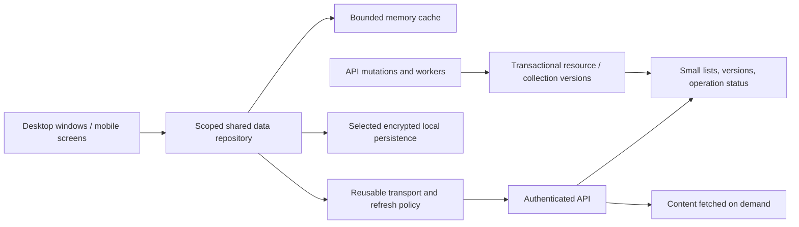

# Data transfer and caching architecture review

Date: 2026-11-23. Scope: desktop and mobile clients, REST API, live gateway, workers, schema, and committed GCP Stage 0 deployment configuration. The baseline review below is retained to explain the changes. The implementation sections describe the current working-tree code and local validation, not a deployed release or measured production savings.

## Decision

Implemented one scoped data-access layer per client, explicit processing state, selective memory/encrypted-disk caching, conditional reads, and demand-driven history/work synchronization. The existing live pipeline, prepared packs, content-hash reuse, and worker idempotency remain in place.

The changes address request ownership and lifecycle together with storage: a cache alone would leave duplicate polling, missing-result loops, and server wake behavior intact. Practice and Personal AI reads remain fresh because their current representations combine content with reconciliation/runtime behavior; separating those contracts is deferred.

## Baseline findings that set the implementation priority

This section describes the code before this change. Line references identify the reviewed baseline and may have moved. The implemented behavior and exact current policies follow it.

### 1. Missing content is incorrectly used as evidence of active work

Desktop `useCatalog` reads both applications and interviews every four seconds when an application has no pack, a resume is extracting, or an upcoming interview has no pack. Call setup and Applications create independent instances. Visited tabs stay mounted, and those pollers do not depend on tab visibility. With both instances mounted and the condition persisting, the nominal schedule is four full-list requests every four seconds: 60 GETs per minute, before other traffic. This is a code-derived scenario, not a measured production rate.

Mobile Applications treats an unavailable pack as processing and repeats at least three lists approximately every five seconds while visible. An expired or failed pack can remain unavailable without an operation running.

Separate two concepts:

- Content availability: missing, current, stale, expired.
- Operation state: queued, running, succeeded, failed, cancelled.

Only queued/running operations justify repeated status checks. Terminal failure, unsupported inputs, and expiration need an explicit user action or bounded recovery policy, not endless reads. Polling must have one owner per operation, no overlapping requests, backoff on errors, a deadline, and visibility/foreground rules.

Evidence: `apps/desktop/src/Applications.tsx:58-81,121`; `apps/desktop/src/CallScreen.tsx:261`; `apps/desktop/src/App.tsx:88-94,212-216`; `apps/mobile/src/Applications.tsx:146-162,236-244`; `apps/desktop/src/usePolling.ts:4-10`.

### 2. Desktop recreates its HTTP connection pool

`AppState::api` creates a new `ApiClient` for each ordinary API command; its constructor builds a new `reqwest::Client`. Keep a reusable transport in the native process. Authentication, account/profile context, and request cancellation remain request-scoped; they must not become mutable global headers on the pooled transport.

Evidence: `apps/desktop/src-tauri/src/lib.rs:347-356,727-738`; `apps/desktop/core/src/api.rs:104-113,149-165`. The [reqwest documentation](https://docs.rs/reqwest/latest/reqwest/struct.Client.html) recommends reusing the client to reuse its connection pool.

### 3. Small refresh needs retrieve large representations

- Mobile Work Context refreshes logs, document metadata, memory, proposals, the selected log, and optionally a document together. Loading older logs also calls unrelated endpoints.
- Desktop Ask retrieves the whole conversation approximately every second while generating. Mobile does the same approximately every 1.5 seconds. The API decrypts old messages for each response.
- Desktop completed-call detail immediately fetches replay. Mobile fetches detail and transcript together. Heavy content should be loaded when the view needs it and retained by version.
- A work-log page performs attachment and extracted-fact queries for each log. A page of 30 logs can perform 60 related SQL queries in addition to its initial list query. Batch these reads and keep list representations smaller.
- Application list responses load and parse prepared-pack JSON to display a small status summary. A compact status representation can avoid repeated full-pack reads.

Evidence: `apps/mobile/src/WorkContext.tsx:367-401`; `apps/desktop/src/Ask.tsx:45-59`; `apps/mobile/src/Ask.tsx:237`; `apps/api/src/copilot_api/routes/ask.py:168-180`; `apps/desktop/src/SessionDetail.tsx:63-87`; `apps/mobile/src/History.tsx:124-149`; `apps/api/src/copilot_api/routes/employers.py:362-425`; `apps/api/src/copilot_api/routes/applications.py:77-94,186-197`.

### 4. Existing timestamps and revisions are not cache-validation contracts

Work-log completion/failure updates status without advancing `updated_at`. Company documents lack a general update timestamp. Sessions lack a resource revision; notes change independently; a post-call rerun replaces outputs. Replay reference labels come from current memory titles.

Responses also combine multiple sources. A company includes log/document/proposal counts. An application includes resume state and Valkey pack availability, which can change through expiration without a database edit. A validator based only on the parent record's timestamp would incorrectly report these representations unchanged.

Practice has a database revision, but its GET does not expose it; the response also includes elapsed time and configuration-dependent voice flags. Personal AI request revision changes on request refresh, while publishing changes `active_version_id` independently.

Evidence: `apps/worker/src/copilot_worker/workplace.py:192,207`; `migrations/0006_company_workspaces.sql:53`; `migrations/0001_initial.sql:147`; `apps/api/src/copilot_api/routes/sessions.py:251,338`; `apps/worker/src/copilot_worker/sessionlog.py:678-712`; `apps/api/src/copilot_api/routes/employers.py:248-275`; `apps/api/src/copilot_api/routes/practice.py:54-95,272-295`; `packages/core/src/copilot_core/personal_ai.py:303-305`.

### 5. Blanket GET caching changes behavior

Ask and Practice reads currently mark overdue operations failed. Profiles can synchronize external users. Practice speech GET can invoke generation, although completed operations are reused. These routes cannot all receive the same generic cache policy. Move timeout recovery to an explicit status/reconciliation path before bypassing those reads.

Both clients currently discard HTTP response headers in their JSON API contract; mobile treats 304 as an error. Server ETags alone therefore do not implement conditional caching. Handle validators and 304 in the shared transport/repository layer. Authenticated private responses must remain private; preserve explicit `no-store` contracts until deliberately redesigned. See [HTTP caching, RFC 9111](https://www.rfc-editor.org/rfc/rfc9111.html).

Evidence: `apps/api/src/copilot_api/routes/ask.py:109-115,175`; `apps/api/src/copilot_api/routes/practice.py:275-291,800-818`; `apps/api/src/copilot_api/routes/profiles.py:77-128`; `apps/mobile/src/api.ts:250-268`; `apps/desktop/core/src/api.rs:149-165`.

### 6. Cloud savings depend on server sleep as well as request volume

Committed Stage 0 configuration runs an e2-medium VM with a 30-minute idle shutdown. API, gateway, worker, PostgreSQL, Valkey, queue, and proxy share the host. Reducing reads saves CPU and transfer; it does not automatically reduce provisioned VM running time.

Desktop startup deliberately wakes the VM. Almost every API command may wake it. Idle detection counts ordinary API requests regardless of response size/status, so a 304 can keep it awake. Established gateway connections also prevent shutdown. A permanent invalidation WebSocket on that gateway would conflict with this deployment model.

Request policy needs explicit intent: cached data permitted, refresh only if the server is already awake, or an interactive action requiring the server. Evaluate cache eligibility before server wake. Do not exempt real work from idle detection until in-flight operations are accounted for reliably. Background work on this same VM cannot promise continuous updates while it is stopped.

Evidence: `infra/gcp/envs/stage0/terraform.tfvars:23,71`; `infra/gcp/host/copilotctl.sh:304-320`; `apps/desktop/src-tauri/src/lib.rs:727-738,2202-2214`.

## Implemented architecture

Desktop `core/src/data_cache.rs` owns transport-independent response reuse, deduplication, cache scope enforcement, and encrypted persistence. The native process shares it across windows, including direct `api_call` users. The native shell reuses a pooled `reqwest::Client`. The TypeScript catalog has one owner per account/profile; setup and interview prep subscribe to it. Mobile's `Api` owns its repository and preserves its account epochs and captured profile semantics.

Keys include the configured deployment origin, account identity/epoch, captured profile, path/query representation, and cache schema version. Native identity claims partition storage but never authorize access. Server `X-Copilot-Account` and `X-Copilot-Workspace` headers establish canonical scope before a private stored body is accepted; a changed scope purges/fences old data. The configured cloud origin is stable across VM IP changes. The desktop UI's remount key includes deployment origin and account, and profile changes remount its private screens.

Account, link, profile, and deployment transitions invalidate old context and reject late responses/cache writes. Accounts sharing a workspace still retain separate account-private history/Ask behavior. Authorization, current link access, per-session privacy, and parent existence are checked before conditional validation. Concurrent requests share one in-flight result, including compact no-store status reads, without retaining those results for later callers. Mutation generation changes fence obsolete reads; desktop retries only bounded same-identity races.

### Resource policies

These are maximum local reuse windows, not immutable-data promises. Server `no-store`, `no-cache`, and shorter `max-age` take precedence. Live/pending/queued/running/processing/extracting/ingesting/indexing/ending content has no reusable freshness window. Explicit Refresh bypasses the local freshness window. Every response still belongs to the captured account/profile.

| Resource | Desktop | Mobile | Server validation / persistence |
| --- | --- | --- | --- |
| `/call-languages` | 24 hours | 24 hours | Configuration/version ETag; encrypted persistence; non-sensitive catalog may be reused within its TTL after restart |
| `/profile/call-preferences` | 60 seconds | 60 seconds | Memory only; local changes invalidate |
| `/sessions` metadata pages | 30 seconds | 30 seconds | Account-scoped opaque page cursors; history delta invalidation; no collection ETag or private persisted index |
| Completed session detail, transcript, replay | 30 seconds | Detail 30 seconds; transcript/replay local ceiling 300 seconds, capped to server 30 seconds | Per-session revision ETag; replay also covers reference-label revision; encrypted persistence with online private validation after restart |
| Employers, work logs/documents, facts, proposals | 30 seconds | Local ceiling 60 seconds, capped to server 30 seconds | Work revision ETags and delta invalidation; desktop persists eligible ETag bodies, mobile persists individual log/document details |
| Applications, interviews, resumes, uploaded documents | 15 seconds | 30 seconds | Memory only; mutations invalidate dependent groups; status/pack availability checked fresh while processing |
| Desktop job lists/details | 15 seconds | Not allowlisted | Memory only |
| Saved Ask conversations and context options | 30 seconds | 30 seconds | Memory only; pending conversation/message data stays fresh |
| Usage | 30 seconds | 60 seconds | Memory only; relevant mutations invalidate |
| Meeting preparation | Fresh | 60 seconds | Mobile memory only; explicit refresh/mutations bypass or invalidate; provider sync remains an explicit operation |
| Practice, Personal AI, calendar connection/control, signed URLs, profiles/link/access, live/seat/companion control | Fresh | Fresh | No general content caching; action authorization stays authoritative |
| Processing status and pending Ask message | Fresh, no wake on background polls | Fresh | Compact `no-store` response; simultaneous readers may share a flight |
| Audio and live generated output | Existing live transport | Existing live transport | No new REST cache or permanent invalidation socket |

Native allowlisting is in `apps/desktop/core/src/data_cache.rs`; mobile policy is in `apps/mobile/src/dataCache.ts`; server conditional allowlisting is in `apps/api/src/copilot_api/data_cache.py`. Unknown routes remain fresh. The history list deliberately lacks an ETag because a live privacy marker may precede its durable flush; rebuilding its small metadata page checks current visibility. A completed old session can still change through notes, reruns, deletion, privacy/access changes, or replay reference labels.

### Request lifecycle and smaller representations

Pack `availability` (`current`, `missing`, `expired`) is independent of `operation_state` (`queued`, `running`, `succeeded`, `failed`, `idle`). Only queued/running state starts pack status polling. Worker markers are bounded and cleaned when the owning account is deleted. A missing/expired/failed pack does not trigger an endless list loop.

Processing polls are sequential, stop on terminal state, pause while the screen/window or mobile app is inactive, use error backoff capped at 30 seconds, and have a deadline (normally five minutes; desktop pack preparation 60 seconds and Work test question 90 seconds). Existing live/seat discovery is a separate visibility-scoped fresh query. Desktop poll requests use `api_call` flags `{refresh:true,wake:false}`; explicit foreground actions may wake the server. Catalog mutation events debounce visible reloads across desktop windows.

Desktop active catalog/history/work views perform one cache-aware read when returning to the foreground; mobile does likewise through its screen/request lifecycle. The repository decides whether the TTL requires a network read. There is no repeating timer for settled history/work content. Explicit History Refresh preserves the loaded page depth and uses opaque cursors when supported.

Desktop call review loads replay only when Transcript/Replay or a transcript citation is opened. Mobile transcript loads on demand. Ask polls only the pending message and keeps previously loaded messages. Mobile loading an older Work-log page requests only that page. The API batches log attachment/fact reads instead of issuing two related queries per row.

## Versioning, synchronization, and edit contracts

Migration `0028_data_revisions.sql` adds RLS-protected scoped domain revisions and coalesced resource changes/tombstones. Database triggers cover relevant API/worker writes and cascades for history and work resources. A locked workspace clock serializes committed changes across both domains; this avoids relying on sequence values allocated before commit. History child changes invalidate the owning session; reference-title changes separately invalidate replay labels. Work aggregate versions cover child status/content/count changes.

Eligible conditional reads authenticate and authorize first, inspect small revision metadata, and can return 304 before content decryption/serialization. `cache_context.py` keeps version and representation reads in one repeatable-read snapshot. ETags cover account/workspace, representation path/query, application representation version, resource dependencies, and language configuration where relevant. Clients handle 304 in their transport and retain the prior authorized body; they do not treat 304 as an empty successful JSON response.

Successful writes invalidate dependent local groups and emit desktop data-change events. Work-log detail/list/write receipts and session detail expose numeric `revision`. Work-log PUT and session-notes PUT accept `expected_revision`; a conflicting edit returns 409. Work-log `expected_revision=-1` means create only when that day is absent; `0` is a valid existing pre-migration revision. Clients freeze the loaded revision while a draft is dirty, preserve the draft on conflict, display the latest saved text for review, and use the successful receipt's new revision. Omitted expectations retain compatibility with older clients.

### HTTP contracts

- `GET /sessions?cursor=...` returns `sessions`, `next_cursor`, and legacy `next_before`. The opaque cursor is bound to account/workspace and uses descending `(started_at,id)` boundaries, including equal timestamps. Privacy filtering continues scanning database pages until enough visible rows are found or the source is exhausted. A page cursor is separate from a synchronization cursor.
- `GET /sync?domain=history|work&cursor=...` returns `{reset,revision,cursor,changes:[{resource,id,deleted,revision}],has_more}`. No cursor bootstraps a watermark with `reset:true`; clients capture it before their first list read. Invalid, expired, or foreign-scope cursors reset safely. Cursors last up to 30 days; tombstones are retained at least 31 days. A paginated catch-up holds a fixed upper watermark; later writes appear on the next pass. Changes carry identifiers and revisions, not decrypted content.
- `GET /applications/status` returns compact `applications` (id, resume_status, pack), `interviews` (id, pack), `resumes` (id, status), and `documents` (id, status). Pack contains only pack_id/available/availability/operation_state. Clients reload full lists only when metadata changes.
- `GET /sessions/{id}/status` returns `{id,status,revision}`. `GET /employers/{id}/status` returns `{revision,work_logs:[{id,status}],documents:[{id,status}],pending}`. Both are fresh status reads.
- `GET /ask/conversations/{conversation_id}/messages/{message_id}` returns the same message shape used in conversations, scoped to that account and conversation. It performs pending-operation reconciliation without reloading/decrypting the whole conversation.

History/work synchronization is demand-driven when visible reads need freshness, with a 30-second check window and at most 20 catch-up pages per pass. It does not keep the server awake on its own. Native history changes evict affected session bodies/list pages; reference changes evict replay; work aggregates invalidate conservatively. Mobile invalidates domain-dependent groups and affected persistent records. Deletions evict stored copies; an authoritative missing resource returns 404, never stale fallback. Large/incomplete catch-up fails safely and continues on a later request.

### Storage, privacy, and wake behavior

Desktop memory and disk each have a 32 MiB/256-entry budget; individual persisted representations are at most 2 MiB. Disk uses AES-256-GCM with a platform SecretStore key, authenticated scope/path/schema metadata, and hashed filenames. Only eligible bodies carrying ETag plus canonical account/workspace metadata are persisted. Mobile memory is 4 MiB/128 entries; its AES-256-GCM OS-cache archive is at most 2 MiB/64 entries, 512 KiB per entry, with 30-day retention and a device-only SecureStore key. Mobile persistence is limited to the non-sensitive language catalog and selected completed session/work details.

Private disk data is a conditional-validation candidate after restart, not an offline authorization grant. It must be authorized online for the current canonical account/workspace before display, even if its saved TTL has not elapsed. A private network/auth failure never exposes a cold stored body. The non-sensitive language catalog can be reused within its TTL. Memory already validated in the current process may be reused within the declared freshness window; there is no stale-on-error fallback beyond that window. Logout, account/link/profile/deployment changes, relevant mutations, deletions, and authorization failures purge/fence affected storage.

Native cache lookup precedes VM wake. Passive startup probes and hidden discovery do not deliberately wake the VM, and background poll requests use `wake:false`. Opening a visible signed-in workspace can legitimately wake it for fresh profile/link checks and private online validation; startup is not universally network-free. A cache hit avoids its request and its associated wake, but 304 is still a server request and may count as activity under the existing idle policy. No permanent invalidation WebSocket was added.

## Existing infrastructure to preserve

Valkey is configured with 192 MB maximum memory and `noeviction`, and already holds live state and prepared material. Do not fill it with a general history/document response cache. New Redis/CDN infrastructure is not needed for these first improvements.

Existing reuse includes content hashes for extraction/indexing, durable worker idempotency, digest/pack versions, prepared answers, guarded answer reuse, per-session embedding/search reuse, provider prompt caches, and a short in-process unwrapped-key cache. Reading encrypted records repeatedly costs local decryption and serialization, but does not imply a fresh Cloud KMS operation for every row.

Ask also checkpoints its growing partial answer to the database at most about twice per second. That write path remains even if client GETs are cached. Measure it separately before changing checkpoint durability or introducing transient streaming state.

Evidence: `infra/gcp/host/copilotctl.sh:112-117`; `apps/worker/src/copilot_worker/runtime.py:124`; `apps/worker/src/copilot_worker/packs.py:120`; `apps/gateway/src/copilot_gateway/retrieval.py:81`; `packages/core/src/copilot_core/crypto.py:239-290`; `apps/api/src/copilot_api/routes/ask.py:734-740,863-882`.

## Rollout order and acceptance evidence

This working tree has not been deployed. Release in dependency order:

1. Apply migration `0028_data_revisions.sql` to establish revision tables, triggers, RLS, and pagination index. Verify migration/RLS checks against the target database before exposing the new API handlers.
2. Deploy the API and workers together with revision-aware conditional/status/sync routes and pack operation markers. Keep legacy `next_before`, optional edit preconditions, and additive response fields while older clients remain in use.
3. Release desktop and mobile clients after those backend contracts are available. Clients tolerate a missing sync endpoint, but compact status and create-only conflict contracts require the new backend; that fallback is not a reason to reverse rollout order.
4. Validate account/profile/link transitions, shared-workspace access, second-device edits, worker completion, deletions, equal-timestamp pages, expired cursors, private restart/offline behavior, and server asleep/foreground return on the deployed environment.

Local validation during implementation:

- Desktop TypeScript typecheck passed. The complete desktop UI suite passed 616 tests across 59 files, including the final hidden-startup/create-only changes. Tests cover shared catalog ownership, missing/expired/failed pack inactivity, sequential polls/backoff/deadlines, foreground refresh, pending-message reads, lazy replay, cursor page preservation, draft-preserving 409 handling, and profile isolation.
- Desktop release-script unit checks: `node --test scripts/release-checks.mjs` passed 10 tests.
- Native `cargo test -p copilot-client -p copilot-desktop --lib` passed 92 client tests (1 existing skip) and 186 desktop-shell tests (6 existing skips); shell `cargo check` also passed. This includes 11 cache tests plus a 401/304 wire test, covering encryption, budgets, scope fencing, no-store flight sharing, conditional reads, and private cold validation.
- Mobile's suite passed 175 tests; typecheck and native Expo exports for both iOS and Android passed. Tests cover TTL/header policy, scope changes, deduplication, storage invalidation, synchronization, paging, and edit conflicts. Platform AES/keychain behavior has not been exercised on physical mobile hardware.
- The consolidated backend API, worker, core, and migration/RLS suite passed 1,543 tests against the local test stack with a workspace-local temporary directory. After the final review fixes, 624 targeted cache/profile/worker/pack/RLS tests passed. Backend Ruff checks passed; Pyright reported no errors or warnings.

These checks establish functional behavior, not production savings. Baseline and compare request count/bytes by route and action, visible/hidden request sources, cache hit/miss/revalidation, database query/decryption/serialization time, VM awake time and wake reason, and generation/STT cost separately. Nginx already logs path/status/bytes/duration; API logs request duration. Measure cold first load and repeat navigation independently.

## Intentionally deferred optimizations

Practice needs a pure stable-content/revision contract separate from timeout reconciliation, elapsed time, speech generation, and runtime capabilities before it is safe to cache. Personal AI needs separate request/active-version metadata and versioned private brief content. Both currently fetch fresh to preserve behavior. Calendar provider synchronization also remains explicit rather than implying that revalidating a client cache refreshes the external provider.

Application/interview/resume collections still return full content after a detected status change, and Work delta handling conservatively refreshes dependent metadata. If these lists grow materially, introduce smaller list projections, resource-specific work validators, and cursor pagination/virtualization before creating an unbounded local index. History already has deterministic page cursors; Ask message pagination and any generation-only streaming remain future work. No general Valkey/CDN response cache or extra always-on service is required for the implemented changes.
