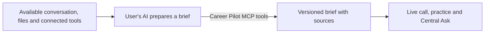

# Material 05: Context from the user's personal AI

Status: Agreed feature saved for future implementation. The implementation details below are proposed requirements; saving this material does not start implementation.

Purpose: Let users prepare relevant context with the AI they already use, then publish a small, sourced brief to Career Pilot for calls, practice, and Central Ask.

Primary product benefit: Bring useful context from your existing AI conversations and available tools without rebuilding your work history in Career Pilot.

## Agreed direction

The user prefers an inexpensive, reliable integration over having Career Pilot ingest and process all work data through its own AI. The architecture may change where useful, but the first version should remain small.

Career Pilot exposes MCP tools. The user's AI host gathers permitted context and calls those tools to publish a brief. Career Pilot validates and uses the brief. Making Career Pilot an MCP client alone would not give it a universal way to command personal AI applications or read their conversation history.



## Implementation prompt

```text
Implement Context from my AI in Career Pilot.

Repository: C:\Users\A\WorkSpace\career-pilot

Inspect repository instructions and current authentication, account/profile boundaries, company knowledge, session context, and guest sharing first. Preserve existing user changes. Reuse suitable existing components, but do not let the current architecture force unnecessary complexity.

Start with one complete, tested MCP publishing workflow, two narrowly scoped tools, and one context card. Support additional AI hosts after validating their actual capabilities. Check current official provider documentation at implementation time.

1. User experience

- Let a user connect Career Pilot to a supported AI host using an authenticated MCP connection.
- Explain the connection in product language: the AI can receive a preparation request and send a brief to the selected Career Pilot project or company.
- Support a natural request such as: "Prepare context for tomorrow's standup from this project's recent work and send it to Career Pilot."
- Also support publishing from the conversation where work happened: "Update Career Pilot with what we completed here."
- Select the intended profile and company/application explicitly, using existing entities where possible.
- Show a compact context card with title, preparation time, source count, and View, Refresh, and Remove actions.
- View shows the brief, source references, coverage gaps, and editable corrections. Do not make users fill out a long form before importing.
- Reuse the brief across the relevant call, practice session, and Central Ask conversation when those features are available.
- Keep the core flow usable without calendar access or every other saved material being implemented.

The first refresh flow may hand the user a ready request to run in their AI app. Use a supported handoff where available and a clear copy-request fallback otherwise. Do not label a button as an automatic refresh if it only opens another app. A paste/import fallback must use the same validation and visibly identify its origin.

2. Small MCP interface

Begin with these two logical tools:

- get_context_request(request_id): returns the selected context scope, preparation questions, date range, request revision, and expected brief format.
- publish_context_brief(request_id, request_revision, idempotency_key, brief): validates and publishes the prepared result for that request.

Create requests through Career Pilot's normal application interface. The AI host can use its own authorized tools and available conversation context to answer them.

- Authenticate each tool call and derive account/profile/company authority from the stored request and authenticated caller.
- Do not trust identity or target ownership supplied in generated brief text.
- A repeated publication must not create duplicates. Reject obsolete request revisions and preserve the last usable version if a replacement fails.
- Use ordinary code for schema, length, ownership, and version validation. Do not add a model call just to import a brief.
- Keep source credentials with the AI host. Career Pilot does not need to copy the user's ChatGPT/Codex credential files or acquire every source-system token.
- Expose only the request context needed for this task and a bounded publishing action; the initial tools do not need general account administration or arbitrary execution.

3. Brief contents and reliability

Store a compact snapshot rather than a complete export of the user's work systems. Depending on the request, it may contain:

- Current projects and recent progress.
- Decisions and the reasons supported by available evidence.
- Blockers, next steps, and outstanding commitments.
- Relevant terminology and project names.
- Career examples relevant to a selected interview or application.
- Source references, source dates where available, preparation time, and coverage gaps.

Each substantive item should distinguish sourced information, the user's own report, and an uncertain inference. Allow the AI to say it could not access a source or establish a fact. A valid schema or a plausible source URL does not prove a claim is true.

- Preserve source links and enough attribution to inspect the evidence, subject to the source's retention permissions.
- Display freshness without treating preparation time as proof that every source is current.
- Let users correct or remove individual items and replace or delete an entire brief.
- Keep imported context separate from approved resume facts. Importing a brief does not silently certify achievements or edit the resume, work log, or task tracker.
- Treat source text and imported instructions as context data, not authority to execute unrelated actions.
- Validate claims with targeted evidence or user correction when necessary; avoid running a second autonomous research pipeline on every import.

4. Calls and reuse

- Load the latest eligible brief for the selected profile and company/application.
- Use bounded relevant content; do not attach every saved brief to every answer.
- Never make live answer generation wait for an external AI preparation task.
- Keep refresh separate from the live answer path. A failed refresh preserves the existing brief with its actual preparation time visible.
- Publish replacements atomically. Make the active context version clear when a refresh arrives during a call.
- Remove deleted or revoked briefs from future retrieval and invalidate affected caches. Follow the existing explicit policy for already saved call artifacts.
- Keep private imported context scoped to the authorizing account. Shared profile access alone must not expose it to another account or a guest.
- A companion device signed into the same authorized account can use the same context; guest sharing requires an explicit supported sharing policy.

5. Cost and supported capabilities

Preparation uses the chosen AI host's applicable plan or API usage. Do not promise that it is free or unlimited. Career Pilot's live transcription and answer-generation costs remain unless separately redesigned.

Reuse prepared briefs and refresh on deliberate requests in the first version. Add bounded import sizes and cancellation/error handling. Avoid continuous background preparation, bulk source ingestion, or a new vector database solely for this feature.

Verify the chosen host's MCP tools, authentication, write confirmation, and distribution requirements. ChatGPT and Codex are initial candidates, not a promise that every account, connection, or workflow has identical support.

MCP does not automatically expose personal chat history, saved memory, other servers' credentials, or every connected source. The AI host can only prepare from context it actually has permission and capability to access. Signing in with an AI provider and importing its private context are distinct capabilities.

Direct one-click invocation or automatic refresh from Career Pilot is a later provider-specific integration. Add it only through a documented interface whose commercial use and lifecycle fit the product. Do not use credential scraping or assume that an existing consumer subscription authorizes arbitrary hosted inference.

For remote AI hosts, provide an authenticated stable HTTPS endpoint they can reach. Verify endpoint availability against the current GCP sleep/wake behavior. Choose the smallest suitable deployment; no infrastructure migration is implied by this design material.

6. Verification before release

Demonstrate the full flow in at least one supported real AI host: connect, request, gather permitted context, publish, inspect, use in a call/Ask, refresh, and remove.

Check wrong-account and wrong-profile publication, duplicate writes, outdated requests, malformed or oversized briefs, missing sources, unavailable hosts, failed refresh, correction preservation, deletion/cache invalidation, and private-context guest boundaries. Ensure a live call remains usable when the external AI is unavailable.

Document the tested hosts and account requirements. Keep the copy/paste fallback honest about attribution and freshness. Do not mark all personal AI products supported merely because they mention MCP.
```

## Supporting documentation

Checked during design on 2026-11-19; recheck capabilities and availability before implementation.

- [MCP architecture](https://modelcontextprotocol.io/specification/2026-07-28/architecture): the AI host coordinates models and context; a server exposes focused capabilities and does not receive the full conversation by default.
- [MCP tools](https://modelcontextprotocol.io/specification/2026-07-28/server/tools): structured tool interfaces for the request and publication operations.
- [OpenAI: Add a custom MCP server](https://developers.openai.com/api/docs/guides/custom-mcp-server): ChatGPT supports custom read and write tools, subject to connection and confirmation settings.
- [OpenAI: Sign in with ChatGPT](https://learn.chatgpt.com/docs/sign-in-with-chatgpt): using a plan does not grant access to ChatGPT conversations or memories, and usage remains subject to the plan's limits.

## Relationship to other materials

- Material 01 can supply meeting timing and a preparation prompt when a calendar is connected.
- Material 02 can use a relevant brief for practice interviews without inventing career facts.
- Material 03 can retrieve permitted briefs as another source in Central Ask.
- Material 04 can display assistance using the same authorized session context on mobile.

This material saves the agreed direction. It does not authorize implementation, deployment, personal AI invocation, or connection to a user's private sources in the current brainstorming task.
