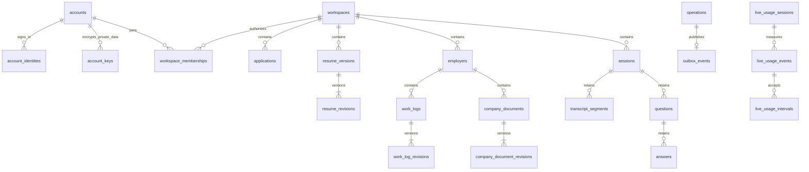

# Production data foundation

Introduced in November 2026 by migrations `0029`–`0035` and the corresponding
application changes. Check the deployed image tag and `public.schema_migrations`
for a particular environment's rollout status. This is the schema and execution
model to carry forward into production. Scaling the
deployment does not require replacing this ownership model or moving billing out
of interview-history rows later.

## Ownership and relations

The diagram shows the main relations. Accounting attribution deliberately survives
content/account deletion, so its account/workspace/session UUIDs are identifiers,
not cascading foreign keys into the content tables.

| Boundary | Authoritative records | Meaning |
| --- | --- | --- |
| Sign-in account | `accounts`, `account_identities`, `refresh_tokens`, `account_keys` | Authentication, account status/preferences and private encryption keys |
| Shared work | `workspaces`, `workspace_memberships`, `user_keys` | Context and content ownership; owner/editor/viewer access; independent workspace key lifetime |
| External person mapping | `external_workspace_links`, `profiles` | External identity and UI profile selection; membership is required independently |
| Private tools | Ask, practice, integrations, calendar and personal-AI tables | Owned by the authenticated account; selecting a shared workspace grants no access to another account's private tools |
| Career/work context | Applications, employers, memory, sources and their revisions | Scoped by workspace, with same-workspace and same-employer composite foreign keys where applicable |
| Live session | `sessions`, retained children, `session_writer_claims`, `session_write_batches` | Durable admission, immutable source/payer snapshots, current writer generation, privacy and finalization |
| Accepted work | `operations`, `outbox_events`, `scheduled_jobs` | Durable input, publication, leases, retries, cancellation and schedule deduplication |
| Usage | `usage_prices`, `live_usage_sessions/events/intervals`, `usage_adjustments`, `legacy_usage_estimates` | Append-only measured time and price attribution, independent of history retention |
| Cleanup | Session expiry fields, `object_deletions` | Bounded, retryable cleanup after domain deletion |

Existing UUIDs and ciphertext associated data are preserved. Personal accounts and
their original workspaces can have the same UUID but are separate rows with separate
lifetimes. Existing private wrapped keys are copied without reencrypting old data;
new private and workspace keys are independent, including their in-process cache keys.

`app.users` is a security-invoker compatibility view over `workspaces`, and
`app.job_runs` is a compatibility view over `operations`. `identities` and
`career_os_people` likewise expose the canonical `account_identities` and
`external_workspace_links` records for compatibility. Existing workspace-domain
`user_id` columns remain for compatibility; explicit workspace aliases document their
meaning. New code must distinguish actor account from selected workspace. These views
support existing domain SQL, not an unrestricted rollback to old application binaries.

API transactions set both `app.account_id` and `app.user_id`. Account-private RLS uses
the former. Workspace access also checks active membership, with viewer write denial.
Membership changes serialize on the workspace so concurrent requests cannot remove
the last active owner. Removing an account preserves shared workspaces that still
have members, while its private rows and private keys are removed. Private sessions
are deleted with their private owner; they are never made shared by clearing that owner.
Content-free account tombstones prevent deleted account UUIDs from being recycled.
Signing up again cannot reclaim a retained shared workspace or inherit the previous
account's usage attribution.

## Source revisions and history

Resume, work-log and company-document containers have `current_revision_id` pointers.
Content changes append immutable revision rows; routine status changes do not rewrite
the historical source. Resume extraction text is retained separately for its revision.
New sessions pin an exact resume revision/hash. Existing historical sessions keep an
unknown revision instead of falsely claiming today's resume was used in the past.
New Ask resume citations resolve the pinned revision after later edits. The revision
API is `GET /v1/resumes/{id}/revisions` and `GET .../revisions/{revision_id}`.

Extraction and pack identities include source revisions. Workers capture a revision
before external work and recheck it before publication. Changing A → B → A cannot
reuse the completed operation for the first A. Original file keys are immutable;
an unchanged Career-OS pull preserves its existing revision and object. Explicitly
deleting a source container still deletes its revisions; this is not an undeletable
archive, and replacing an entire company-document container follows its existing
replacement/deletion behavior.

## Accepted work and process boundaries

Requests commit domain changes and accepted operations in one PostgreSQL transaction.
Queue work also writes an outbox row in that transaction. The worker's dispatcher
publishes outside the transaction, with bounded parallelism, timeouts and stable event
IDs. A queue outage leaves accepted work discoverable. Publication and execution are
at least once; database deduplication and guarded commits make retries safe.

Workers claim renewable leases with an owner UUID and increasing generation. Domain
transactions verify the lease before commit. Shared cache publication takes a short,
bounded guard while checking source/operation ownership. Model calls do not hold the
operation lock. A superseded worker cannot commit a result or overwrite the new
generation's status. Expensive work reaches a durable `dead` state after five failed
attempts; `operations.retry` is an explicit administrative retry. Domain retry actions
create a new attempt. Persistence and maintenance remain recoverable.

The current worker reserves persistence concurrency independently of ordinary AI jobs.
Ask/practice generation uses the `interactive` lane and a bounded executor hosted by
the API by default. The accepted operation survives an API restart. It can later run
as `copilot-interactive` (or `python -m copilot_api.interactive`) with API-hosted
execution disabled using `COPILOT_INTERACTIVE_RUNNER_ENABLED=false`. The standalone
process uses API configuration and credentials (`COPILOT_API_DATABASE_URL`), including
the same crypto/provider/storage settings; it does not replace the worker or scheduler.
Multiple executors coordinate through the same database leases.
No HTTP response or process-local background-task list owns accepted generation work.

The current SQS/ElasticMQ transport stays in use. A different queue protocol requires
an adapter and contract tests; changing a URL cannot turn SQS into Pub/Sub. API,
gateway, worker and the optional interactive process use configured service endpoints
and bounded pools, so compatible managed services and separate compute can be adopted
without replacing the data model.

## Live admission, privacy and durability

The gateway creates the durable session before sending `session.ready`, then binds a
writer generation and lease. Admission/renewal failures stop service when ownership
cannot be established. A takeover fences the old writer. Short database guards and
content-free receipts validate retained batches; receipts from a valid earlier
generation remain flushable after takeover. Private audience is checked in the
database for the session and retained children, including history pagination.

Retained payload still passes through Valkey before the worker writes it to PostgreSQL.
The receipt is not a second copy of the payload. Loss of Valkey's unflushed contents
can therefore lose uncommitted transcript/usage data. Bounded buffers and admission
failure behavior limit this window; they do not make one VM highly available. Provider
calls and live audio streams also cannot be made exactly once by a database migration.

Connected host time includes silence and excludes reconnect downtime, setup, guests,
`no_call`, and work after disconnect. New durable admission pins payer and price before
the first interval. Usage estimates count only accepted intervals; replayed or overlapping
intervals cannot double charge. See [usage metering](usage-metering.md) for rounding,
legacy sessions, crash tails and the USD5/hour tracking configuration. Payments,
invoices, entitlements and prepaid balances are not enabled by this change.

## Retention and query cost

Session admission snapshots a valid workspace `retention_days` policy into `expires_at`.
The migration snapshots that policy for existing sessions. An unset policy preserves
the existing indefinite-retention behavior; changing a policy affects subsequent
sessions unless an explicit backfill is run. Maintenance deletes only expired, ended,
fully drained sessions with no live writer. The accounting ledger is untouched.

Source deletion transactionally records object-deletion intents. The janitor reserves
bounded batches, checks all retained source references, and performs storage calls
outside database transactions. Failed deletion retries; reserved/deleted object keys
cannot be reused. Completed flush-operation metadata is purged after 30 days, longer
than the current queue and dead-letter retention; other operation audit rows remain.

The design keeps ordinary relational joins and targeted indexes. Membership lookups,
session children, history, usage by payer/day, runnable operations, source revisions,
pack status and cleanup all have scoped access paths. History privacy and operation
status can be read from PostgreSQL without depending on per-row Valkey authorization.
Pool sizes and query limits remain bounded. Time-based partitioning and usage rollups
are later physical optimizations driven by measured call hours and row counts; no
account sharding, database-per-user, or universal entity table is introduced.

## Rollout on the existing VM

The rollout preserves VM sizing, service topology and idle shutdown. Payment collection
remains disabled. The current testing deployment can run these services; it is not
certified for 1,000 concurrent calls.

1. Take a verified database backup and preserve the previous image/config versions.
   Rehearse the full migration chain on a restored copy, including RLS roles and keys.
2. Schedule a coordinated cutover: stop admitting calls, drain existing calls and
   retained logs, and stop old API/gateway/worker/scheduler writers.
3. Apply all pending migrations with the normal migration runner, then start the new
   worker, API and gateway together, and restart the scheduler or its timer. This ownership
   migration changes RLS and write contracts: do not run old writers against the new
   schema as a rolling upgrade.
4. Check account/profile access, shared/private history, resumed sessions, outbox
   delivery, extraction, cancellation and usage reconciliation before reopening access.
5. If cutover fails, keep writes stopped and use the rehearsed forward fix or restore
   the matched database backup and old application versions. Do not edit applied SQL
   files or assume image rollback alone reverses the ownership migration.

The GCP release helper implements this sequence with `stage.py deploy --coordinated`.
An operator first runs `stage.py prepare-host` when the host helper changes, updating
its boot copy and installed copy without restarting services or changing IAM. CI verifies
that boot copy before deployment. A persistent maintenance marker keeps writers stopped
after a migration failure, including across VM restarts. See the GCP deployment runbook
for recovery commands and backup locations.

Before serving the eventual large production workload, separately validate the
deployment: representative load tests, provider quotas, fleet connection budgets,
queue lag, restore/PITR, managed-store failover, retention sizing and recovery of
unflushed payload. Those are deployment and capacity gates, not a planned second
replacement of this account/workspace/session architecture. The earlier
[1,000-call design study](1000-concurrent-users-redesign.md) records workload assumptions
and future infrastructure choices, including ideas beyond this implementation.
