# Desktop UI audit

2026-10-29, on `main` at `eed5205` (desktop 0.1.16, after #43). Stage 1 of the UI redesign; the
proposal that answers this audit is [ui-proposal.md](ui-proposal.md).

**How this was done.** The desktop UI ran in a browser through the [design harness](harness/README.md):
the app's own code, unchanged, with the Rust core faked by fixtures. Fixtures are fictional
(Alex Rivera, Northwind Freight and so on). Every screen was captured in its loaded, empty, loading,
error and long-content states, in both themes for the main screens, and the overlay mid-call, while
answers stream, compact, narrow, at reduced opacity, with click-through on, with its menu open
and with a degraded connection. That is 75 screenshots in [screens/before/](screens/before/), plus
[metrics.json](screens/before/metrics.json): page heights, type sizes, and how far the overlay's
content moves while an answer streams. Main window shots are 1080×780 and overlay shots are
760×620, both the default sizes. The overlay shots sit over a busy stand-in for a video call,
because the overlay window is transparent.

**What it can't show.** Real WebView2 font rendering on Windows at 125% or 150% scaling,
multi-monitor overlay moves, the OS file picker, and real hotkeys. Everything else on screen is the
real UI.

## Top problems, ranked

Your request left the list of what bothers you most as a template, so this is my ranking from the
audit. Reorder it when you review and the proposal's priorities will follow.

1. **Overlay text fades with the window.** The opacity setting fades the whole overlay, text
   included. Over a light shared screen, answer text is 4.2:1 at 60% opacity and 2.1:1 at 35%,
   below the 4.5:1 that WCAG AA asks for. ([35%](screens/before/overlay-opacity-35.png))
2. **The answer you are reading moves.** The answers pane follows its newest content. While a
   question's detailed answer streams, its talking points slide up the screen: the latest fast
   answer's top edge moved from y=427 to y=199 (228 px) in 9 separate jumps during one answer.
   There is no fixed place to look. ([frames 1–5](#streaming))
3. **Compact view shrinks the text.** Compact is the mid-call view, but it drops talking points
   from 15 to 13 px and the detailed answer from 13 to 12 px. The question is 12 px muted text in
   every view, and labels are 9–10 px.
4. **The Session tab is the setup form in every state.** During a call it shows the same form,
   greyed out, with nothing about the call itself. After a call, the summary renders *under* the
   form, starting about 690 px down, below the fold at the window's minimum height.
5. **Long single-column pages with inline editors.** Opening an application inserts a ~950 px
   editor above the list and pushes the list off screen (page height 1,914 px). Settings is 1,474 px
   with one Save button at the bottom. Career-OS and the device pickers save at once, everything
   else waits for Save.
6. **A PDF job description cannot start an application.** Add needs JD text, and a PDF upload
   needs a saved application, so a user who only has the PDF is stuck.
7. **States are inconsistent.** Loading, empty and error look different on every screen.
   Interviews has none of them. Errors render above unrelated forms, and the profile switch
   disappears while loading, which shifts the header.
8. **Destructive actions confirm three different ways, or not at all.** There are native
   `confirm()` dialogs, typed confirmations, and some deletes with no confirmation (a company
   document, "Reject all", attachments, facts, disconnecting Career-OS).
9. **Accessibility gaps.** The focus ring is a 22% blue glow (1.36:1 against white) and only exists
   in the main window. The overlay has none. Clickable rows (`<tr onClick>`) can't be reached by
   keyboard. The tabs aren't a tablist. Icon buttons are named by their glyph ("⚙", "A−").
   Status chips are 3.0–3.1:1.
10. **No design system.** Thirteen root variables sit beside about 60 hard-coded colors, 11 font
    sizes from 9 to 28 px and 13 radii, all in one 2,007-line `styles.css`.

## Shell and navigation

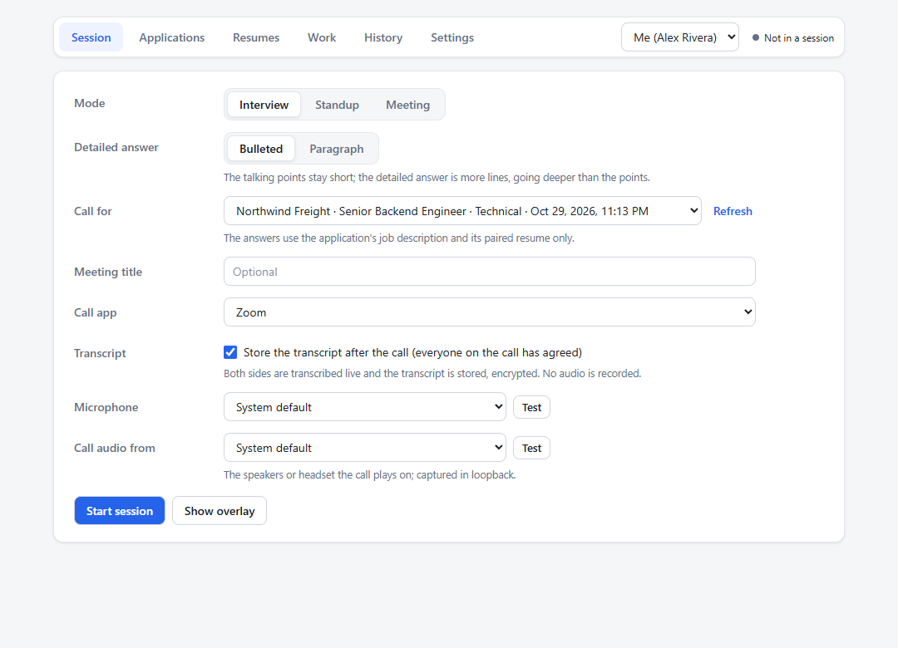

- There are six top tabs plus a hidden Debug tab. The order (Session, Applications, Resumes, Work,
  History, Settings) mixes "do a call", "prepare" and "review" with no grouping.
- The header's right side holds the profile switch and the status badge. The switch only appears
  once profiles have loaded, so the header shifts on every launch
  ([loading](screens/before/applications-loading.png)). While a call runs, the switch is disabled
  with only a tooltip to say why.
- The status badge shows raw codes: "Stopped: ended", "Stopped: session_active".
- Locked (Career-OS link required): every tab is clickable, but all of them show the same one-line
  callout over an empty page ([locked](screens/before/session-locked.png)).
- The update bar sits under the tabs and works well
  ([update ready](screens/before/session-update-ready.png)). It is the one status surface that is
  consistent.
- The dark theme follows the OS and can't be overridden
  ([dark](screens/before/session-start-dark.png)).

## Session (start, live, end, post-call)

| Ready | Standup | Running, ending |
|---|---|---|
|  | 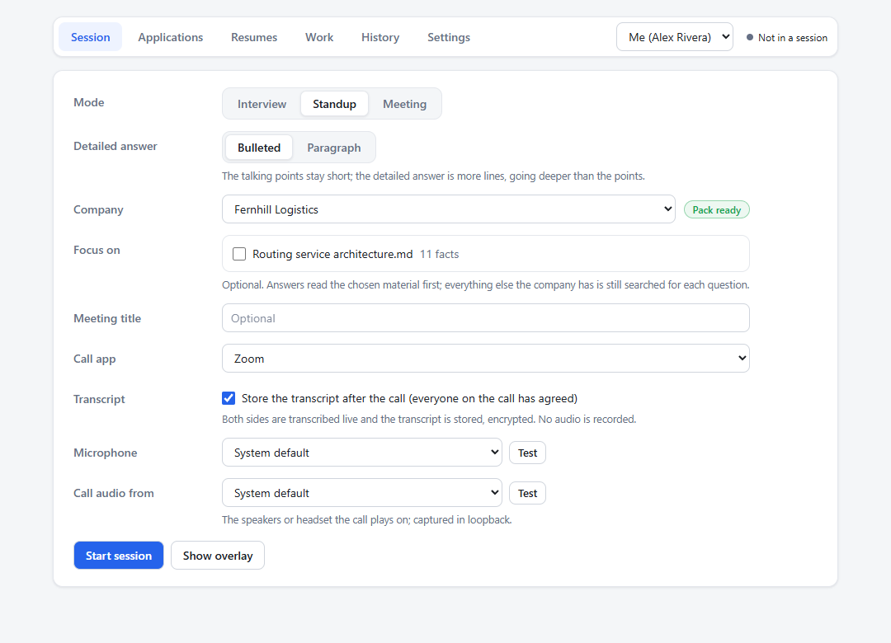 | 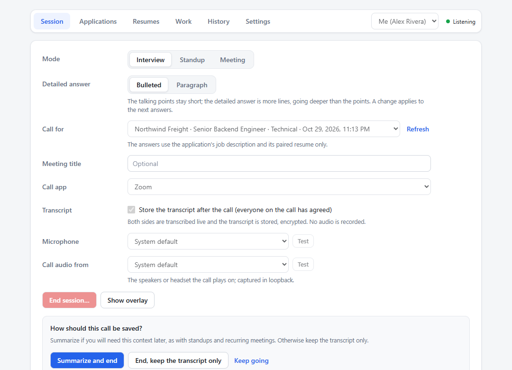 |

- **Nine rows before Start.** Mode, Detailed answer, Call for, Meeting title, Call app, Transcript,
  Microphone, Call audio, then the buttons. Most rows rarely change between calls (call app,
  devices, answer style), but each one gets the same weight as Call for. The Start button sits at
  y=597, below the fold at the window's minimum height of 520 px.
- **Help text everywhere.** Five grey notes on the ready screen, and each one is a full sentence.
  The useful ones (consent, which resume the answers use) blend in with the rest.
- "Meeting title" shows for interviews too. "Refresh" next to Call for is a manual step for
  something the tab already reloads when shown.
- **Running.** The same form, greyed out. There is no elapsed time, no last question, and no level
  meters. The only live element is the badge in the header. "End session…" turns into an inline
  panel with three choices that can fall below the fold
  ([end choice](screens/before/session-end-choice.png)).
- **Post-call.** The summary appears under the start form
  ([post-call](screens/before/session-postcall.png)). The user who just ended a call sees the form
  for the next one, and the result they want is off screen.
- **First run** ([empty](screens/before/session-start-empty.png),
  [signed out](screens/before/session-signed-out.png)). A "Sign in first" callout sits above a full,
  usable-looking form. Nothing says what else a new user needs: a resume, the Career-OS link, an
  audio check. Start is enabled with no resume at all.
- Another session active: the callout and its "End the other session" action are clear
  ([other active](screens/before/session-other-active.png)).

## Applications

| List | Editor open | Long list |
|---|---|---|
| 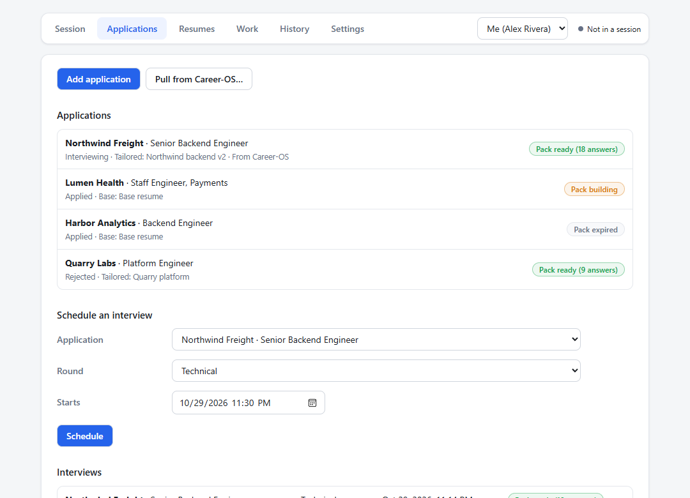 | 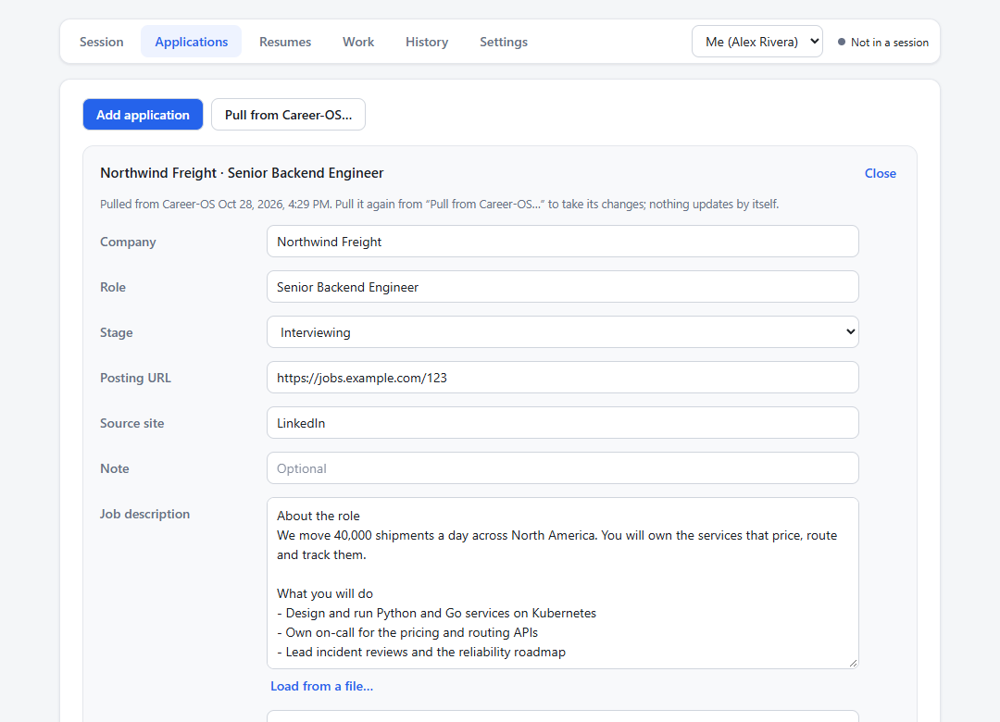 | 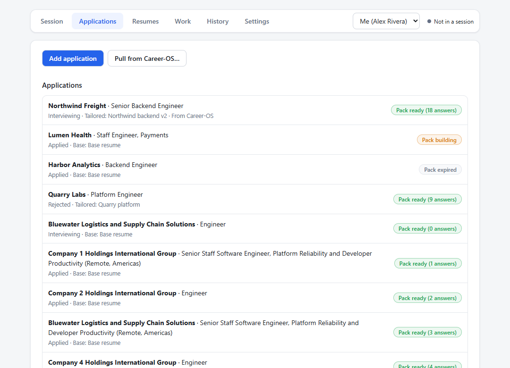 |

- **Three jobs on one page.** The applications list, an inline "Schedule an interview" form, and
  the interviews list. The interviews (the thing most worth seeing) are last, below the form.
- **The editor opens inline above the list** and pushes it off screen. The page grows to 1,914 px
  for an existing application ([editor](screens/before/applications-editor.png)) and 1,837 px for a
  new one. There is no way to see the list and an application side by side.
- The editor mixes application fields, the JD, and two ways of adding a tailored resume (paste,
  upload), plus a resume picker with a long label ("Automatic: its tailored resume, else the base
  (now: …)").
- **PDF JD dead end.** See Top problems #6.
- Row text "Base: Base resume" repeats itself. Pack chips read "Pack ready (1 answers)".
- **Long content** ([long](screens/before/applications-long.png)). Roles wrap to two lines, and
  there is no search, filter or sort on a 40-row list (page height 3,869 px). Interviews keep the
  same layout.
- **States.** Loading shows a spinner line but leaves the schedule form visible with an empty
  application picker, and Interviews shows a heading with nothing under it
  ([loading](screens/before/applications-loading.png)). The error text appears at the top in red,
  with the empty sections still drawn ([error](screens/before/applications-error.png)). The empty
  state is a single grey line ([empty](screens/before/applications-empty.png)).
- **Pull from Career-OS** opens as another inline panel, with a table, a search row and a
  paragraph of explanation ([pull](screens/before/applications-pull.png)). It works, but it looks
  nothing like a dialog even though it behaves like one.
- **Delete application** uses the browser's `confirm()`.

## Resumes

| Loaded | Long |
|---|---|
| 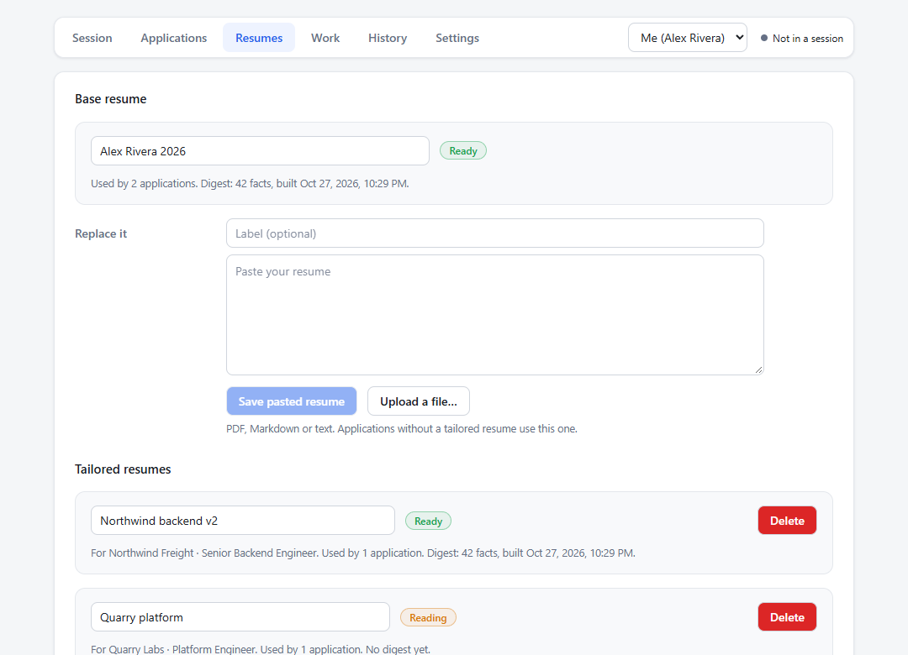 | 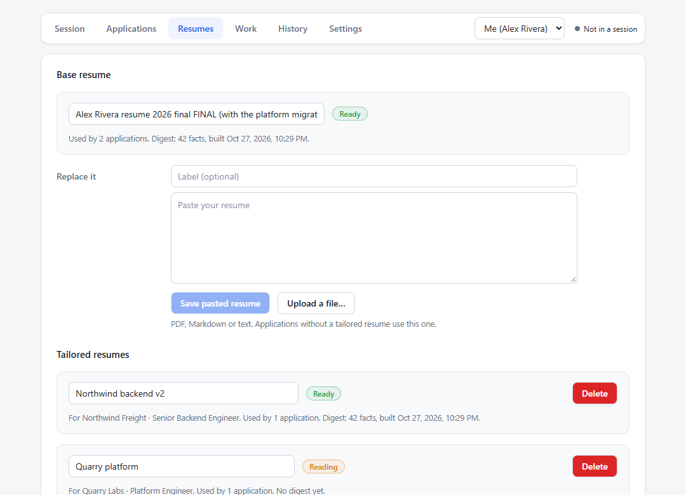 |

- The base resume's label is a bare text input that saves when you leave it. Nothing says it is
  editable or that it saved.
- "Replace it" is always open: a label field, a 6-row textarea and two buttons take up more room
  than the resume they replace.
- Each tailored row has a solid red Delete button. That is the heaviest element on the page, for
  the rarest action.
- Tailored resumes are managed in two places, here and in the application editor, with different
  controls.
- The facts line ("Used by 2 applications. Digest: 42 facts, built …") is dense and reads as a log
  line.
- States: [empty](screens/before/resumes-empty.png), [loading](screens/before/resumes-loading.png),
  [error](screens/before/resumes-error.png). These are the most consistent of any screen.

## Work

| Work log | Material | Facts |
|---|---|---|
| 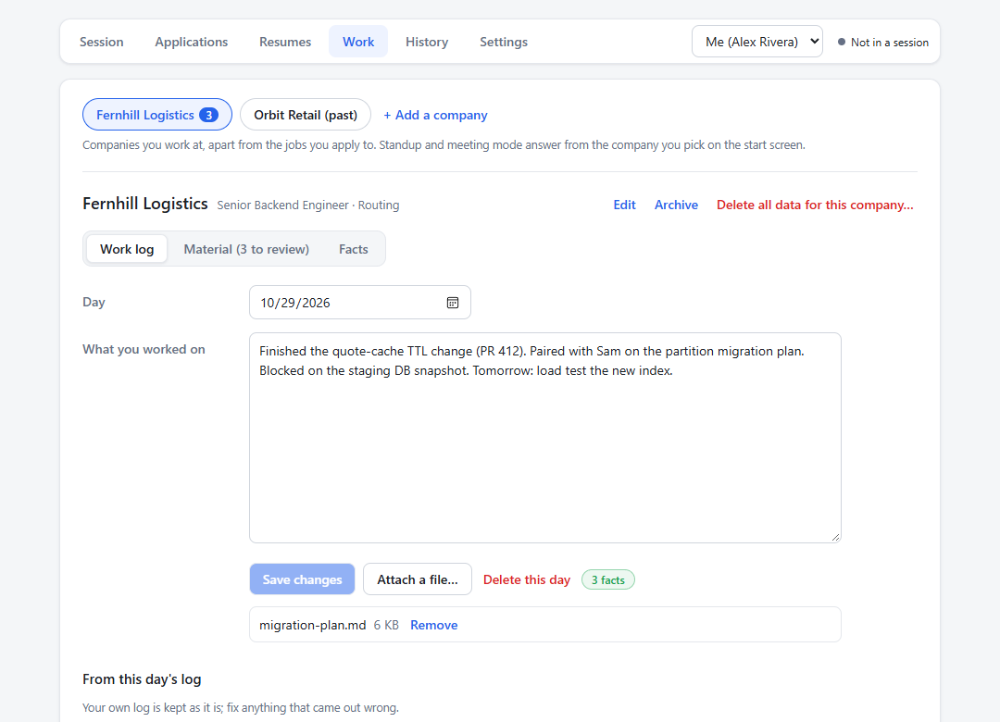 | 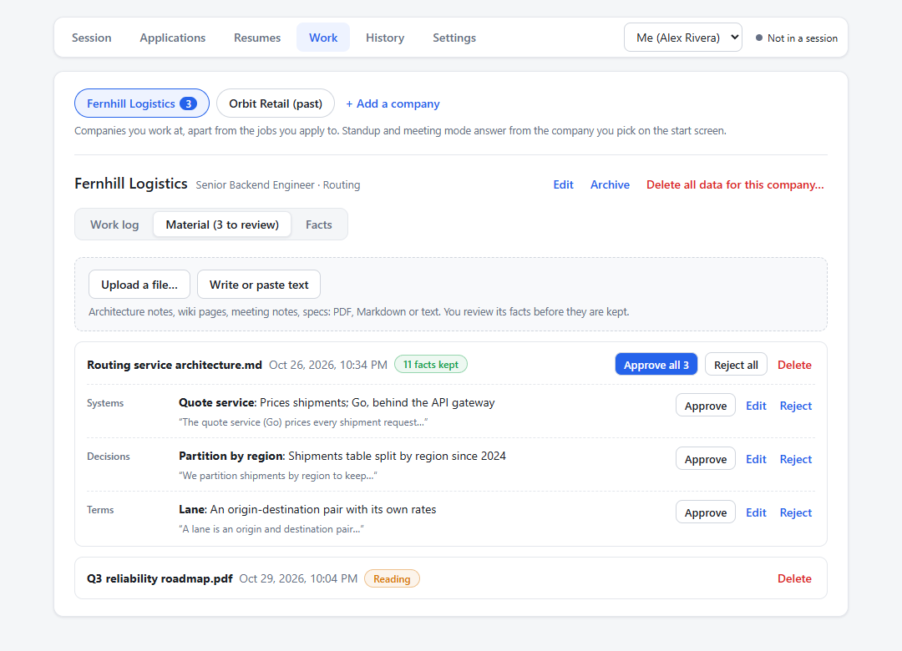 | 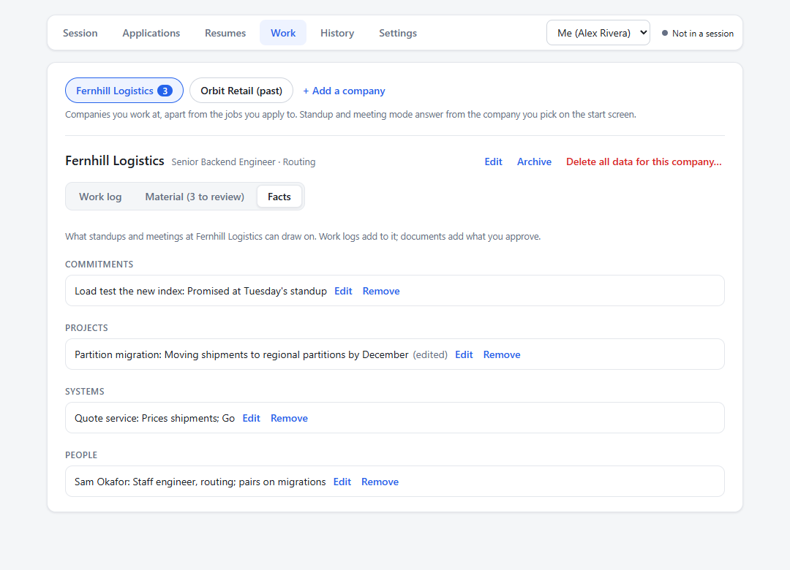 |

- **Three levels of tabs.** The top tabs, then company pills, then a segmented control (Work log,
  Material, Facts), plus a fourth level of kind headings inside Facts.
- "Delete all data for this company…" is a red text link in the header, next to Edit and Archive.
  The typed confirmation it opens is good ([delete](screens/before/work-delete-company.png)), but
  the trigger is too easy to hit.
- **Work log.** The day picker is a bare date input. The save button reads "Save changes" even for
  a day with no saved text yet, and the status chip sits next to "Delete this day". The past
  entries list is below the editor.
- **Material.** Approve, Edit and Reject on every proposal, plus "Approve all 3" and "Reject all"
  per document. A document's Delete has no confirmation, and neither does "Reject all".
- **Empty** ([empty](screens/before/work-empty.png)). The add-company form with a Cancel button
  that does nothing. The placeholder "Fernhill Logistics" reads like real data.
- **Long** ([long](screens/before/work-long.png)). Company pills wrap, and a long archived name
  takes a whole line.

## History and session detail

| List | Session detail |
|---|---|
| 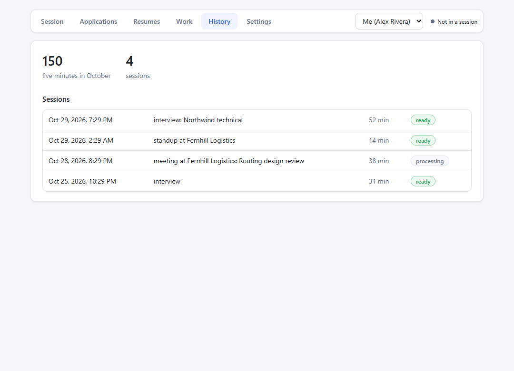 | 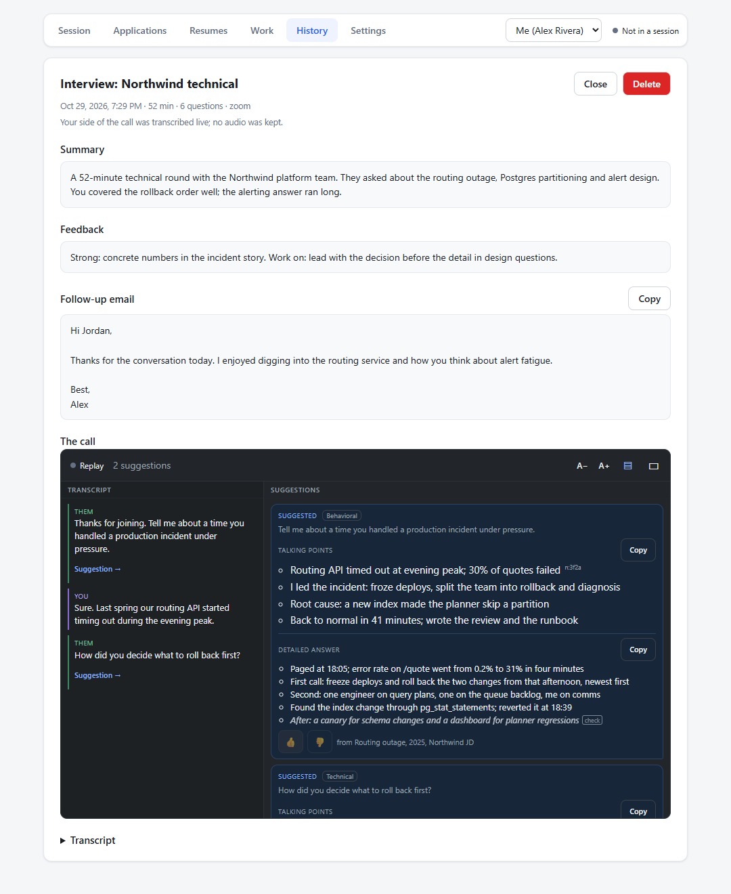 |

- Rows show the mode in lowercase ("interview at …") and the status as a raw word ("ready",
  "processing").
- Rows are `<tr onClick>`: you can't reach them by keyboard, and they show no hover affordance
  beyond the cursor.
- The usage figures ("150 live minutes in October") give no sense of a limit.
- **Session detail.** It replaces the list in place, with "Close" (not "Back") and a solid red
  Delete next to it. The call replay is a dark overlay-styled box nested inside a light page, with
  its own scroll inside the page's scroll. "Transcript" below it shows the same words again, in a
  `
`.
- [Long list](screens/before/history-long.png): 24 rows plus "Older sessions" as a text link.
  [Error](screens/before/history-error.png) and [empty](screens/before/history-empty.png) work but
  are one grey line each.

## Settings

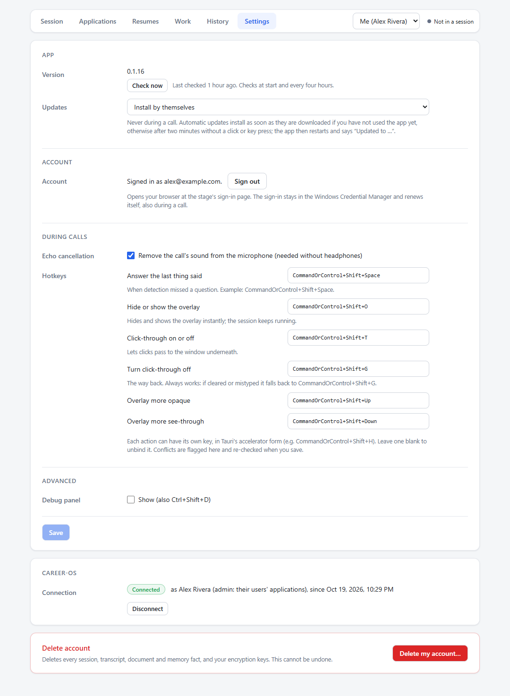

- **One 1,474 px page**: App, Account, During calls (echo cancellation and six hotkeys), Advanced,
  Save, then the Career-OS card, then Delete account.
- **Three save models.** Most fields wait for Save at the bottom. Career-OS connects and
  disconnects at once. The microphone and call audio on the Session tab save the moment you pick
  them. Nothing on the page says which is which.
- **Hotkeys are typed as text** in Tauri's accelerator syntax ("CommandOrControl+Shift+Space")
  instead of being recorded by pressing them.
- The sign-in explanation ("Opens your browser at the stage's sign-in page…") shows even when you
  are already signed in.
- The device pickers live on the Session tab, but echo cancellation lives here.
- Variants: [dev build](screens/before/settings-dev-build.png),
  [signed out](screens/before/settings-signed-out.png),
  [locked](screens/before/settings-locked.png). When locked, the Career-OS card is the only thing
  that matters, and it sits under everything else.

## Overlay

| Mid-call (split) | One column | Compact, small window |
|---|---|---|
| 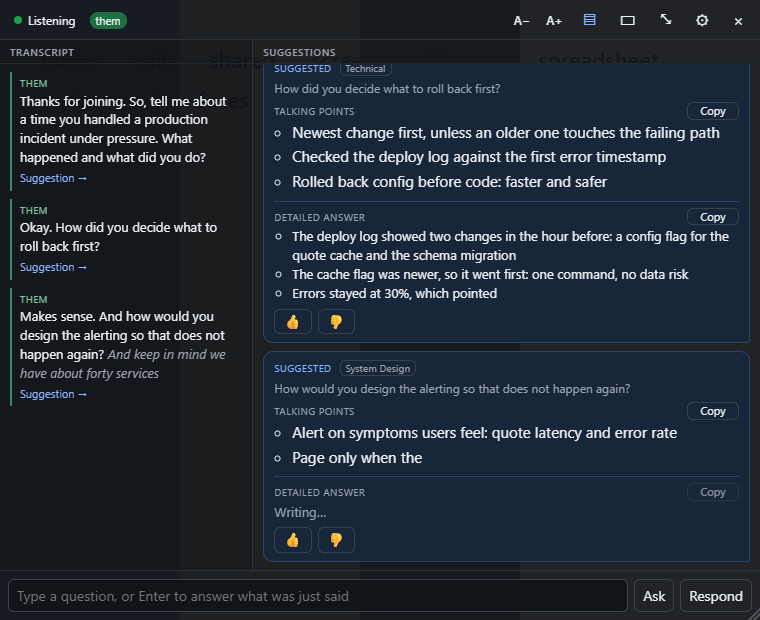 | 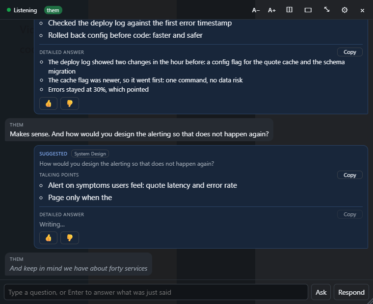 | 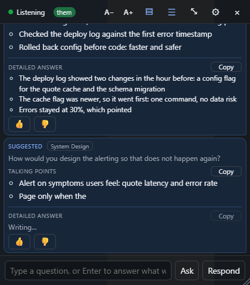 |

**Glanceability.** The overlay is read mid-sentence, so this section matters most.

- **Where to look.** The newest answer is the last card in the right pane, at its bottom edge.
  Older cards have the same weight, the same header and full detailed answers, so the eye has to
  find the newest one every time. Each card repeats a "SUGGESTED" label.
- **Type sizes** (from [metrics.json](screens/before/metrics.json)):

  | Text | Split / one column | Compact |
  |---|---|---|
  | Talking points (fast) | 15 px | 13 px |
  | Detailed answer (deep) | 13 px | 12 px |
  | Question | 12 px, muted | 12 px |
  | Transcript | 13 px | n/a |
  | Labels (TALKING POINTS, tags) | 10 px | 10 px |
  | Citation and "check" tags | 9 px | 9 px |

- **Fast, deep and streaming states.** The only signals are a "Thinking…" or "Writing…" line
  before the first word, and a disabled Copy button. Once text arrives, nothing tells you a pass is
  still writing. A new bullet line shows as an empty "○" until its first word arrives
  ([stream frame 2](screens/before/overlay-stream-2.png)).
- **Opacity** ([60%](screens/before/overlay-opacity-60.png),
  [35%](screens/before/overlay-opacity-35.png)). The window's `opacity` style fades the text with
  the background:

  | Opacity | Answer text over light content |
  |---|---|
  | 100% | 13.9:1 |
  | 60% | 4.2:1 |
  | 35% | 2.1:1 |

  The menu calls this slider "Transparency" but shows opacity ("100%" is fully opaque).
- **Text size.** A−/A+ use CSS `zoom` on the pane content. That works, but 130% still leaves the
  question at an effective 15.6 px ([130%](screens/before/overlay-text-130.png)).
- **Click-through** ([on](screens/before/overlay-click-through.png)). The banner covers the header's
  A− button and names the key in raw form ("CommandOrControl+Shift+G").
- **Menu** ([open](screens/before/overlay-menu.png)). Clear, and the hotkey chips are good.
  "Quit Copilot" sits right under "All settings…" in red, one slip away.
- **Degraded and reconnecting** ([degraded](screens/before/overlay-degraded.png),
  [reconnecting](screens/before/overlay-reconnecting.png)). The badge colour changes but the dot
  is tiny. The text helps ("Answers are slow"), but it is 13 px in the corner.
- **Narrow** ([380 px](screens/before/overlay-midcall-narrow.png)). The panes stack correctly. The
  header's seven icon buttons still fit.
- **Idle** ([idle](screens/before/overlay-idle.png)). Two empty panes and a disabled ask box. Fine,
  but it doesn't offer a way to start.
- **Keyboard.** No focus styles in the overlay at all. Thumbs and icon buttons are named by their
  glyphs.

### Streaming

The harness streams a new question's answers word by word, the way the gateway sends them.

| 0.3 s | 1.2 s | 2.6 s | 4.5 s | done |
|---|---|---|---|---|
| 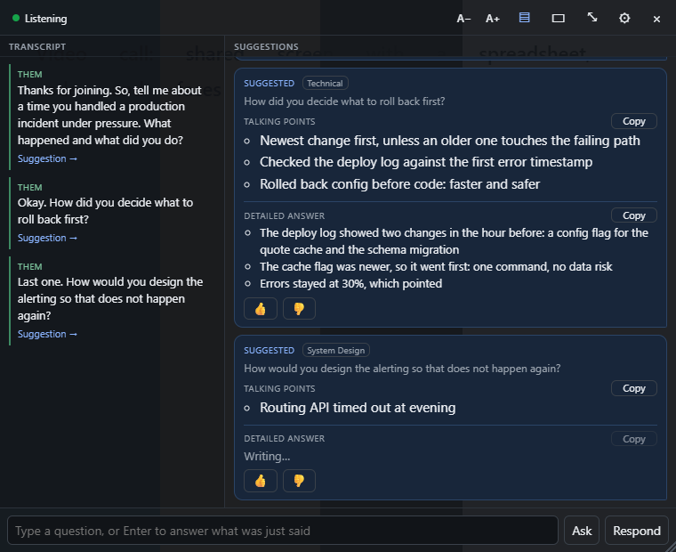 | 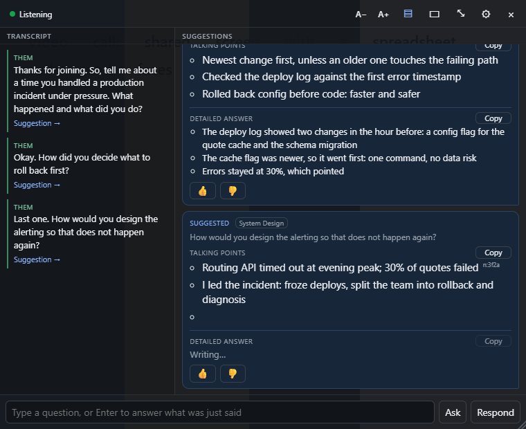 | 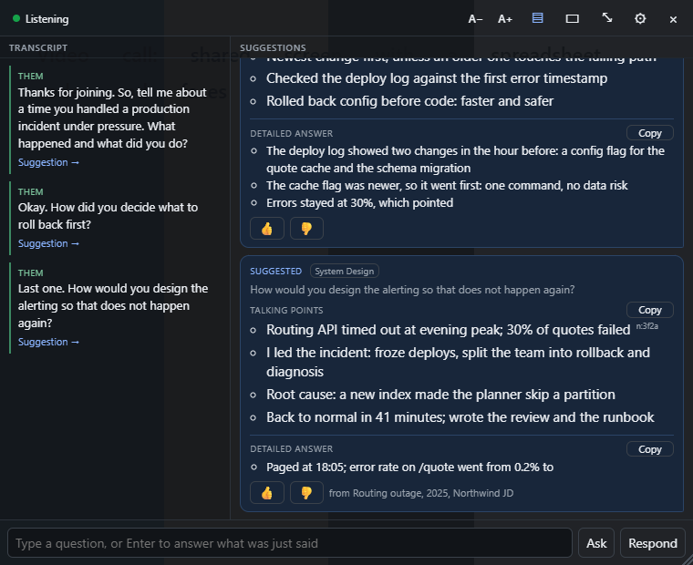 |  | 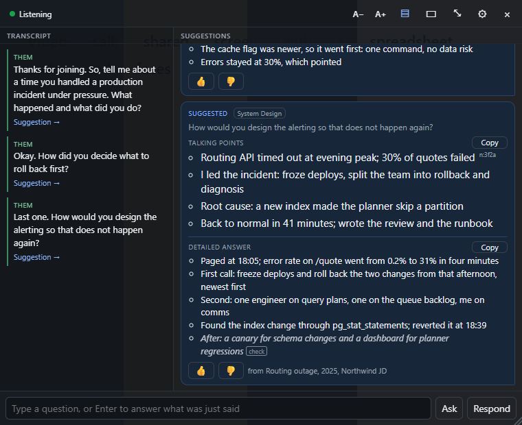 |

The fast answer's top edge, sampled every frame (286 frames): **min 199, max 427, moved in 9
frames**. The browser's layout-shift score stays at 0 because the movement comes from the pane
scrolling to follow new text, not from reflow. To the reader it is the same: the words they are
reading slide up while they read them.

## Debug

[Debug panel](screens/before/debug.png). A developer tool, out of scope for the redesign beyond
taking the new tokens.

## User journeys today

Clicks are deliberate clicks or keys, not counting typing. Screens are the distinct tabs or
panels visited.

| Journey | Clicks | Screens | What gets in the way |
|---|---|---|---|
| **First run** (release build): sign in, link Career-OS if required, add base resume, check audio, start | ~10, plus two trips outside the app (browser sign-in, Career-OS for a code) | Session → Settings (scroll past Save to Career-OS) → Resumes → Session | Nothing lists the steps or shows what is done. The callout says "Sign in first" and nothing else. Start is enabled without a resume. |
| **Add an application with its JD** (paste) | 3 (Applications, Add application, Add), plus 3–4 fields | Applications | The editor pushes the list away. A PDF JD is a dead end (#6). |
| **…pulled from Career-OS** | 3 (Applications, Pull from Career-OS…, Pull) | Applications | The pulled application opens in the long inline editor. |
| **Schedule an interview** | 4–5 (scroll, application, round, time, Schedule) | Applications | The form is detached from the application it belongs to. |
| **Start a call**: interview, next interview preselected | 1 (Start session); the overlay opens itself | Session | The best journey today. A standup adds Mode and maybe Company (2–3). |
| **Mid-call: read the newest answer** | 0, but an eye search: bottom of the right pane, moving while the deep answer streams; if scrolled up, "Jump to latest" | Overlay | Top problems #1–#3 |
| **Mid-call: get a detailed answer** (types not auto-started) | 1 | Overlay | "Get the detailed answer ▾" is a small text link. |
| **Mid-call: less see-through, click-through** | Hotkey, or ⚙ + drag / ⚙ + toggle (2); off by hotkey only, by design | Overlay | The banner covers the controls. |
| **End and review** | 2 (End session…, Summarize and end), then scroll past the form | Session | The summary is below the fold, under the next call's form. |
| **Review a past call** | 2 (History, row); Close to go back | History | The replay is nested in a scroll box. The transcript is shown twice. |

## Measurements

**Page heights at 1080×780** (from [metrics.json](screens/before/metrics.json)): Session
780–861 px, Applications 960 px (editor open 1,914 px, 40 rows 3,869 px), Resumes 1,000 px,
Work 787–1,103 px, History 780 px (24 rows 1,984 px, a session 1,320 px), Settings 1,474–1,531 px.

**Contrast** (WCAG; AA is 4.5:1 for text, 3:1 for UI parts):

| Pair | Ratio |
|---|---|
| Muted text #667085 on white | 4.97 ✓ |
| Accent #2563eb on white, and white on accent | 5.17 ✓ |
| Chip "ok" #16a34a on its tint | 3.11 ✗ |
| Chip "busy" #d97706 on its tint | 3.01 ✗ |
| Chip "bad" #dc2626 on its tint | 4.44 ✗ |
| Focus ring (22% blue) against white | 1.36 ✗ |
| Dark muted #8b949e on #1b1f24 | 5.38 ✓ |
| Overlay text, 60% opacity, over light content | 4.20 ✗ |
| Overlay text, 35% opacity, over light content | 2.14 ✗ |

**CSS inventory**: one 2,007-line `styles.css`; 13 colour variables, about 60 more hard-coded
colours; font sizes 9, 10, 11, 12, 12.5, 13, 14, 15, 16, 18 and 28 px; 13 distinct radii;
`prefers-reduced-motion` handled once; focus styles only under `.page` (the main window).

**Bundle baseline** (`pnpm build`, the one bundle both windows load):

| | Raw | Gzip |
|---|---|---|
| JS | 346.7 kB | 104.0 kB |
| CSS | 23.5 kB | 5.9 kB |
